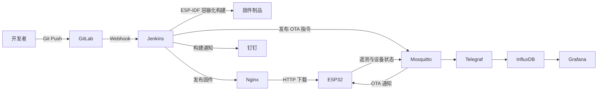
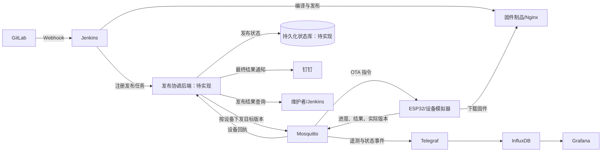

# 面向 ESP32 边缘设备的 OTA 持续交付与可观测性平台

本项目是一套面向 ESP32 边缘设备的 IoT DevOps 实践系统，目标是打通固件从代码提交、自动构建、制品发布、远程升级、健康确认、失败回滚到运行监控的完整链路。最终交付将加入轻量发布协调后端，统一管理发布任务、设备目标状态和升级结果；该后端目前仍处于设计阶段，不能将下文的目标架构视为已部署功能。

项目当前处于毕业设计与硬件联调阶段。构建、消息发布和 OTA 基础链路此前做过测试，但逐设备结果回执与持久化发布状态尚未实现，完整交付闭环仍需验证。真实传感器、安全加固、多设备管理和质量门禁也有待完善。本文档区分已实现能力、历史测试和规划能力，避免将实验环境描述为生产系统。

## 项目目标

- 降低嵌入式固件依赖人工编译、烧录和现场维护的成本。
- 使用 CI/CD 自动生成可追溯的 ESP32 固件制品。
- 通过 MQTT 通知设备拉取新固件，实现远程 OTA 升级。
- 使用 A/B 分区和启动健康检查降低升级失败导致设备失联的风险。
- 采集设备运行状态并构建设备端与服务端的统一监控视图。
- 通过故障注入和量化指标验证交付效率与升级可靠性。

## 课题定位与项目边界

本课题的工程问题是：传统固件发布流程往往只能证明“编译完成、升级指令已发出”，却难以回答“哪些设备最终运行了目标版本、哪些设备失败或回滚、离线设备如何补齐版本”。因此，项目重点是**可追溯的发布状态与可验证的设备升级闭环**，而不是把更多运维软件安装到同一台服务器。

- **主要使用者**：开发者在 GitLab 提交固件；Jenkins 执行构建与制品发布；维护者通过发布状态、日志和 Grafana 判断设备升级结果。
- **核心对象**：固件制品、发布任务、目标设备、设备上报的实际版本与升级事件。`release_id` 关联一次发布的构建、指令、设备回执和实验记录；`device_id` 区分同一发布下的各台设备。
- **演示边界**：真实 ESP32 用于验证 Flash 分区写入、重启健康确认和 Bootloader 回滚；模拟设备用于验证多设备协议、离线重连、超时和故障统计。模拟器不能替代真实硬件回滚证据。
- **完成口径**：至少能区分构建成功、制品已发布、指令已发出、设备已回执和设备升级成功；仅凭 MQTT 发布操作不能证明设备已收到指令。未收到设备确认、设备回报失败或回滚时，不得记录为升级成功。

## 当前系统架构

下图表示仓库中已经有代码或部署配置支撑的链路，不包含尚未实现的发布协调后端。



系统包含两条主要业务链路。

### 固件交付链路

1. 开发者向 GitLab 推送 ESP32 源码。
2. GitLab Webhook 触发 Jenkins 声明式流水线。
3. Jenkins 在 `espressif/idf:release-v5.5` 容器中完成交叉编译。
4. 流水线使用 Jenkins 构建号生成固件版本，例如 `v1.0.35`。
5. 编译产物复制到 Nginx 固件目录。
6. Jenkins 通过 MQTT 发布包含版本、下载地址和摘要的 OTA 消息。
7. ESP32 比较版本、下载固件、写入备用 OTA 分区并重启。
8. 新固件连接 MQTT 后标记为有效版本；未通过健康检查时进入回滚流程。

### 遥测监控链路

1. ESP32 周期性上报温湿度和设备健康数据。
2. Mosquitto 接收遥测消息，Telegraf 订阅并解析 JSON 数据。
3. Telegraf 将数据写入 InfluxDB，同时采集宿主机和 Docker 指标。
4. Grafana 查询 InfluxDB，展示传感器数据与设备运行状态。

## 目标架构与发布协调后端（规划中）

后端是最终项目的正式组成部分，但**当前仓库尚无后端代码、数据库模式或后端 Compose 服务**。设计目标是用一个职责明确的小服务补齐发布结果闭环，而不是再建一套 GitLab、Jenkins 或 Grafana 的替代品。



### 后端职责与边界

| 职责 | 计划行为 | 不负责的事情 |
| --- | --- | --- |
| 发布登记 | Jenkins 在制品可下载后提交唯一 `release_id`、版本、Commit、构建号、URL、大小、摘要及目标设备；后端按 `release_id` 幂等登记。 | 不重新编译固件，也不替代 Nginx 存放二进制文件。 |
| 目标状态管理 | 保存每台设备的期望版本、已报告版本和待处理发布；离线设备重新上线时检查是否需要补发指令。 | 不把一次 MQTT 广播当成持久化的设备期望状态。 |
| 结果归集 | 订阅设备回执，按 `release_id` 和 `device_id` 关联下载、校验、重启、健康确认、失败、回滚与超时事件；重复消息须幂等处理。 | 不将 MQTT 发布成功直接等同于设备升级成功。 |
| 查询与通知 | 提供发布任务及单设备结果查询；按最终结果通知钉钉，并为可观测性链路提供发布事件。 | 不替代 Grafana 的时序图表，也不建设通用设备管理后台。 |

发布任务和设备最终状态需要可查询、可恢复的**权威记录**；InfluxDB 继续承担遥测与指标分析，不默认兼任发布状态数据库。持久化方案与后端语言尚未定型，实施时以单机部署、可备份、可测试、易维护为选择标准，避免为了后端再引入一组不必要的中间件。

## 技术栈与组件状态

| 领域 | 组件 | 当前状态 | 作用 |
| --- | --- | --- | --- |
| 设备端 | ESP32、ESP-IDF 5.5、FreeRTOS | 已接入，硬件联调中 | 网络连接、遥测、OTA 和回滚 |
| 代码托管 | GitLab CE | 已启用 | 源码管理与 Webhook 触发 |
| 持续集成 | Jenkins | 已启用 | 容器化编译、版本生成、制品发布与通知 |
| 固件分发 | Nginx | 已启用 | 提供固件 HTTP 下载服务 |
| 消息通信 | Eclipse Mosquitto | 已启用 | OTA 指令、遥测和设备状态传输 |
| 数据采集 | Telegraf | 已启用 | MQTT 数据解析及主机、容器指标采集 |
| 时序数据库 | InfluxDB 2.7 | 已启用 | 遥测和监控指标存储 |
| 可视化 | Grafana | 已启用 | 设备与服务端监控面板 |
| 通知 | 钉钉机器人 | 已接入 | Jenkins 构建成功或失败通知 |
| 发布协调 | 轻量后端及持久化状态库 | 规划中，尚无代码 | 发布任务登记、设备期望版本、回执归集、超时判定与结果查询 |
| 代码质量 | SonarQube 9.9 Community | 已部署，待接入 | 计划用于流水线质量检查；C 代码分析方案仍需确认 |
| 镜像仓库 | Harbor | 暂停使用 | 原计划管理容器镜像，因业务调整未进入当前链路 |

> SonarQube Community 版本对 ESP-IDF C 项目的分析能力有限。后续优先接入 `clang-format`、`clang-tidy` 或 `cppcheck`，再根据实际能力决定是否将结果汇总到 SonarQube。

## 当前已实现能力

### 自动化构建与发布

- GitLab Webhook 触发 Jenkins Pipeline。
- 使用固定 ESP-IDF Docker 镜像隔离构建环境。
- 根据 Jenkins `BUILD_NUMBER` 自动生成固件版本。
- 将固件发布到 Nginx，并通过 MQTT 下发 OTA 通知。
- 构建成功或失败后发送钉钉通知。

### ESP32 OTA 与恢复

- 使用自定义 4 MB Flash 分区表。
- 配置 `ota_0` 和 `ota_1` 两个应用分区。
- 以流式方式下载并写入备用分区。
- 通过 MQTT 连接结果进行新固件健康确认。
- 启用 ESP-IDF Bootloader App Rollback。
- 使用 3 分钟软件定时器处理新固件无法连接平台的场景。
- Wi-Fi 断线后采用事件驱动方式重连，避免在事件回调中阻塞。

### 遥测与可观测性

设备当前每 2 秒上报以下数据：

- 温度与湿度。
- Wi-Fi RSSI。
- 剩余 Heap 内存。
- 连续运行时间。
- 当前固件版本。

Telegraf 同时采集宿主机 CPU、内存、磁盘以及 Docker 容器运行指标，并写入 InfluxDB 供 Grafana 展示。

## 当前项目进度（截至 2026-10-19）

下面沿用“模块状态 + 验证记录”的进度口径：**已实现**表示仓库中有对应代码或配置，**曾验证**表示此前有实测结果，**待复验**表示本轮未重新运行该链路。不要把服务部署、MQTT 指令发送和设备升级成功视为同一件事。

| 模块 | 状态 | 当前证据与剩余边界 |
| --- | --- | --- |
| 仓库与部署结构 | 已完成 | `master` 目前以 `6fbe000` 为代码基线；源码、Compose、运行数据、固件制品和秘密配置已分目录。9 个 Compose 镜像已固定到当时服务器在用或已缓存的软件版本。 |
| Jenkins 构建与发布 | 已实现，待复验 | `Jenkinsfile` 包含编译、复制固件、MQTT 发布和钉钉通知阶段；用户此前表示流水线跑通，但本轮没有重新构建或取得构建记录。当前“发布成功”仍不等于收到设备升级成功回执。 |
| ESP32 OTA 与回滚 | 已实现，待复验 | `partitions.csv` 配有 `ota_0`/`ota_1`，`sdkconfig.defaults` 启用回滚，`main.c` 包含 OTA 写入和新固件健康确认；用户此前表示做过升级与回滚测试，仍需保存可复查的分区、版本和串口日志。 |
| 遥测与监控 | 已接入，运行待复验 | 固件遥测代码和 Telegraf、InfluxDB、Grafana 的服务配置已存在；实时面板和端到端数据入库没有在本轮重新检查。真实温湿度传感器尚未接入。 |
| 设备模拟器 | 基础版 | `simulator/mock-esp32.sh` 目前只发送上线状态和温湿度遥测；尚不支持多 `device_id`、接收 OTA 指令或上报升级结果。 |
| 发布协调后端 | 待实现 | 目标职责、状态模型和验收口径已写入本文；仓库中尚无后端入口、持久化模式、API 测试或部署配置。 |
| MQTT 文件日志 | 2026-10-15 曾验证 | 当时日志目录及文件对 UID 1883 可写，`iot-mqtt` 为 `healthy`；`scripts/start.sh` 已加入权限初始化。本轮未复查服务器运行状态。 |
| 质量、安全与论文材料 | 待补齐 | SonarQube 未进入当前质量门禁；设备回执、摘要校验和凭据治理仍待完成。论文草稿中的状态对齐、设备影子和 LWT 测试结论尚需与实现及原始记录对齐。 |

阶段性验证记录：

- **2026-10-15**：服务器上的 4 个 Compose 文件和启动脚本通过配置、语法及 Git 差异检查；MQTT 容器健康，已确认 UID 1883 可写日志。服务器仓库的修改提交为 `6fbe000` 并同步到本地 `master`；按当前决定，未推送服务器 GitLab 仓库。
- **2026-10-19**：本地静态核对了 `Jenkinsfile`、固件分区与 OTA 代码、模拟器脚本。今天的 SSH 连接在认证前被服务器关闭，因此**无法确认当前容器是否仍在运行**；流水线、Grafana 与真实 ESP32 也未在本轮重测。后续补充新进度时，应附构建号、Commit、设备日志或实验记录，而不只写“已完成”。

## 当前限制

项目仍处于测试阶段，目前存在以下已知边界：

- 温度暂时固定为 `99.9°C`，用于异常数据测试，尚未完成真实传感器联调。
- OTA 消息虽然包含 MD5 字段，但设备端尚未执行摘要校验。
- 当前只判断远端版本是否与本地版本相同，尚未实现防降级策略。
- OTA 采用 HTTP，MQTT 允许匿名访问，尚未完成 TLS、账号认证与 ACL 配置。
- Wi-Fi、MQTT 地址及部分服务凭据仍存在硬编码，后续需要迁移到 NVS、环境变量和 Jenkins Credentials。
- OTA 使用统一广播主题，尚未实现设备 ID、设备分组和灰度发布。
- Jenkins 发布 MQTT 消息后即认为发布完成，尚未等待设备返回最终升级结果。
- 尚无发布协调后端，也没有持久化的“发布任务—目标设备—最终结果”关联记录；当前设备离线时可能错过广播指令。
- 源码仓库、容器持久化数据、固件制品和本机秘密配置已经分离；旧目录暂时保留在归档区，待稳定运行后清理。

## 网络环境说明

项目测试环境包含两套网络：

| 网段 | 用途 |
| --- | --- |
| `192.168.100.0/24` | 内网服务测试 |
| `192.168.249.0/24` | 虚拟机桥接与 ESP32 联调 |

当前部分配置分别使用两个网段。后续计划将 IP、端口和凭据移入环境配置，避免因网络切换直接修改源码或流水线。

## 项目目录

```text
/data/devops/
├── iot-devops/               # Git 仓库：源码、部署配置、脚本和文档
│   ├── firmware/esp32-node/  # ESP32 固件工程
│   ├── deploy/               # GitLab、Jenkins、IoT、SonarQube Compose
│   ├── simulator/            # MQTT 遥测模拟器
│   ├── scripts/              # 统一启动、停止和状态脚本
│   └── docs/                 # 架构、部署和毕业设计文档
├── runtime/                  # 容器持久化数据，不进入 Git
├── artifacts/firmware/       # 已发布固件，不进入 Git
├── secrets/                  # 本机环境变量与秘密配置，不进入 Git
└── archive/                  # 迁移前目录和停用组件的可回滚归档
```

详细路径和数据边界参见 [`docs/deployment.md`](docs/deployment.md)。

## 本地启动

启动前，根据实际网段配置 `/data/devops/secrets/iot-devops.env`。该文件不会进入 Git。

```bash
cd /data/devops/iot-devops
./scripts/start.sh
```

查看服务状态：

```bash
cd /data/devops/iot-devops
./scripts/status.sh
```

停止服务：

```bash
cd /data/devops/iot-devops
./scripts/stop.sh
```

启动模拟遥测前，请确认 `iot-mqtt` 容器处于健康状态：

```bash
cd /data/devops/iot-devops
./simulator/mock-esp32.sh
```

## OTA 消息格式

当前 Jenkins 向 `device/esp32/ota` 发布如下消息：

```json
{
  "version": "v1.0.35",
  "url": "http://OTA_SERVER:8081/firmware_v1.0.35.bin",
  "md5": "example-digest"
}
```

后续计划改为包含设备目标、Git Commit、文件大小和 SHA-256 的发布清单，并由设备返回下载、校验、重启和健康确认结果。

### 目标协议与状态口径（尚未实现）

后端、模拟器和 ESP32 应共用一份协议定义；以下字段是设计目标，不是当前 MQTT 消息或已上线 API 的声明。

| 消息 | 必需字段 | 作用与校验 |
| --- | --- | --- |
| 发布登记 | `release_id`、`build_number`、`git_commit`、`version`、`artifact_url`、`artifact_size`、`sha256`、`target_device_ids` | 同一 `release_id` 重试不得创建两个发布；后端须检查目标设备和制品元数据。 |
| OTA 指令 | `release_id`、`device_id`、`version`、`artifact_url`、`artifact_size`、`sha256` | 设备只处理发给自己的指令；版本不合法、制品校验失败或重复指令要有可解释结果。 |
| 设备回执 | `release_id`、`device_id`、`stage`、`result`、`reported_version`、`event_time`、可选 `error_code` | 后端按发布与设备去重并记录时间；设备重启后必须再次上报实际运行版本及健康状态。 |

单设备结果建议按 `pending → downloading → verifying → rebooting → healthy` 流转，并允许在相应阶段进入 `failed`、`rolled_back` 或 `timed_out`。`healthy` 只能由目标版本重启后的设备回报产生；“指令已发送”和“下载完成”均不是终态成功。回滚应保留目标版本、实际运行的旧版本与失败原因，不能仅把它记成普通失败。超时由后端按发布任务判定；迟到回执保留为独立事件并标记为迟到，同时更新设备实际版本，不静默改写已经发出的超时结论。该规则需要状态迁移测试覆盖。

后端最小接口拟包括发布登记、按 `release_id` 查询汇总结果、按 `release_id` 查询逐设备结果及健康检查。设备侧仍通过 MQTT 通信，不为 ESP32 增加必须调用的 HTTP 管理接口。接口路径、错误码和数据库结构在后端实现前作为设计草案确定，不能把本节当作已经存在的 API 文档。

## 两周实施计划（开题阶段）

本节是从当前实现出发的 **14 天拟实施计划**，不是已完成功能清单。课题聚焦于“固件能否可追溯地交付、设备能否确认升级结果、失败后能否恢复”，不以增加平台组件数量作为成果。开题报告和 5–8 分钟 PPT 以这条主线组织。

现状依据：`Jenkinsfile`、`simulator/mock-esp32.sh`、`firmware/esp32-node/main/main.c` 和现有部署配置；回滚机制的验收依据为下方链接的 ESP-IDF 官方 OTA 文档。

### 两周内的交付边界

- 保留现有 GitLab → Jenkins → Nginx/MQTT → ESP32 → InfluxDB/Grafana 链路，优先完善它的结果确认与实验记录。真实硬件只要求 **1 块 ESP32 开发板**完成正常 OTA 和 Bootloader 回滚验证，不新增传感器作为关键依赖。
- 将当前仅发送遥测的 `simulator/mock-esp32.sh` 扩展或替换为可配置的设备模拟器：至少模拟 **5 个独立 `device_id`**，上报遥测、接收 OTA 指令、模拟下载与结果回执，并可注入超时或下载失败。模拟器用于验证消息协议、状态流转和监控链路；它**不能证明** ESP32 的 Flash 分区写入或 Bootloader 回滚正确。
- 为每次发布建立 `release_id`（可由构建号与 Git Commit 组成），让 OTA 指令、设备回执和实验记录可以关联。两周阶段先完成发布协调后端的最小可运行版本：登记任务、保存逐设备状态、接收回执、判定超时和提供查询；界面及复杂权限管理留到后续。
- 区分三个结果：**构建成功**表示固件制品生成，**发布成功**表示制品可下载且 OTA 指令已发出，**升级成功**必须由目标设备重启后回报预期版本及健康状态。设备回报失败、回滚或超过约定等待时间，都不能被记录为升级成功。

### 阶段安排与退出条件

| 时间 | 重点工作 | 可检查的交付物与退出条件 |
| --- | --- | --- |
| 第 1–2 天 | 固定演示范围，记录现有流水线与硬件的成功基线；整理开题报告和 PPT 提纲；轮换已进入仓库历史的测试凭据，并把通知凭据迁入 Jenkins Credentials。 | 留存一次构建号、Commit、制品版本和设备日志的对应记录；报告提纲能回答“做什么、为何做、如何验证”；不在新文档中写入凭据值。 |
| 第 3–5 天 | 定义 OTA 指令与设备状态的最小字段；扩展设备模拟器，支持独立设备 ID、版本、遥测、升级状态和可控故障。 | 5 个模拟设备可同时运行；同一次发布能分别观察成功、下载失败、超时等结果，日志可按 `release_id` 与 `device_id` 检索。 |
| 第 6–8 天 | 实现最小发布协调后端，将设备回执接入发布结果判断，并在 Grafana 展示在线状态、当前版本与升级结果。 | 发布任务及逐设备状态可持久化查询；未收到回执时明确显示超时，不发送误导性的升级成功通知。 |
| 第 9–11 天 | 用真实 ESP32 验证正常 OTA、下载中断和新固件健康检查失败后的回滚；先保存可串口恢复的已知正常固件。 | 每个场景至少重复 3 次，记录构建号、起止时间、设备日志、升级前后版本与结果；真实回滚以设备再次启动旧版本为证据，而不是模拟器日志。 |
| 第 12–14 天 | 汇总构建耗时、OTA 耗时、成功次数/总次数和回滚恢复时间；核对 README、论文草稿与实际证据；完成 5–8 分钟 PPT 和演示预案。 | 形成实验记录表、关键截图/日志、开题报告初稿和可讲清主线的 PPT；未完成能力明确标为“规划中”，准备录屏以应对现场网络或设备故障。 |

实验样本用于工程可行性验证，次数少时不宣称具有统计显著性。若第 8 天仍未打通设备回执，后续优先保证 **真实板正常 OTA + 回滚证据 + 可复现演示**，缩减多设备模拟与界面扩展，不牺牲核心闭环。

论文草稿中关于设备影子、状态对齐、MQTT Last Will 及其测试结果的表述，需要逐条与代码和原始实验记录核对；当前固件、模拟器与流水线尚无足够证据将其列为已验证成果。

### 本轮暂不纳入验收

真实多板灰度、传感器联调、Harbor、SonarQube 深度集成、完整设备管理后台，以及 TLS、Secure Boot、Flash Encryption 的生产级部署，不属于两周开题阶段验收；其中哪些进入最终毕设，按下方“核心必做/可选增强”划分。现有测试网络与明文通信只用于受控实验；公开代码或对外部署前，必须完成凭据轮换和相应安全加固。

## 完整项目交付范围与路线

以下描述的是**最终毕业设计**，不是前述两周计划。项目完成时应有一条可复现的真实板升级/回滚链路、一条可注入故障的多设备模拟链路，以及一个能持久化解释发布结果的后端。各阶段交付以前一阶段的协议和证据为输入，不能以“容器已启动”替代业务验收。

### P0：发布协议、制品和后端（核心必做）

- 冻结发布清单和回执字段，定义状态迁移、超时、重复回执、离线重连以及版本比较规则；为关键协议编写正常与异常测试。
- Jenkins 构建可追溯制品，记录 Commit、构建号、版本、大小与 SHA-256；在登记发布前验证固件文件可下载且摘要一致。
- 新建轻量发布协调后端和持久化状态库：登记发布、保存目标设备列表与期望版本、下发或重发指令、归集回执、判定超时、查询汇总和逐设备结果。重启后发布状态不能丢失。
- Jenkins 把构建与发布登记结果交给后端；最终设备结果由后端按状态触发通知。长时间离线的设备不应占住 Jenkins 执行器无限等待。
- 最小验收：同一次发布可追溯到固件和 Commit；至少两台设备给出不同结果时，后端分别正确显示，重复回执不造成重复成功计数；后端重启后记录仍在。

### P1：真实设备与多设备模拟（核心必做）

- ESP32 使用稳定的 `device_id`，接收定向指令；校验下载长度和 SHA-256，处理重复指令、无效版本、网络中断与异常退出，并报告错误原因、复位原因和重启后的实际运行版本。升级前还需跨重启保存待处理 `release_id`，否则旧固件回滚后难以说明自己对应哪次失败发布；具体持久化方式须经断电场景验证。
- 明确新固件健康条件：仅建立 MQTT 连接可能不足以证明业务可用；须验证目标版本、基本业务任务及必要的状态上报后，再确认新固件有效。保留串口救援和已知可用固件。
- 模拟器支持至少 5 个独立设备、不同当前版本、遥测与在线状态、OTA 指令消费、结果回执，以及下载失败、超时、离线后重新上线等故障注入。
- 后端按目标设备保存期望版本和实际版本；设备重新上线时能够发现未完成任务并补发或提示人工处理。这才是本文所称的最小“状态对齐”，不是单纯的 MQTT 广播。
- 最小验收：真实板分别完成正常 OTA 和新固件故障后的 Bootloader 回滚；模拟器展示成功、失败、超时和离线恢复。模拟器结果不能充当真实 Flash/Bootloader 验证。

### P2：监控、质量与安全（核心必做部分）

- 调整 Telegraf 的订阅与解析配置，将目标状态事件写入监控链路；Grafana 展示设备在线状态、实际版本、发布成功/失败/回滚/超时数量和关键耗时。Broker、后端和设备日志均能按 `release_id`、`device_id` 定位一次升级。
- 为后端状态迁移、MQTT 消息处理和模拟器故障注入建立自动化测试；流水线增加适用于 ESP-IDF/C 与后端代码的格式、静态检查、测试和制品校验门禁。
- 将凭据移出固件源码、Jenkinsfile 和可提交配置；轮换已进入仓库或历史的测试凭据，统一两套网段下的访问配置。受控实验环境至少限制可访问范围；对外部署前再完成 MQTT 认证与 ACL、固件下载 HTTPS/TLS 等加固。
- 最小验收：错误不能被成功通知掩盖；关键场景有自动测试和日志证据；新环境按部署文档能重新启动服务且敏感值不进入仓库。

### P3：实验、文档与答辩（核心必做）

围绕以下场景进行重复实验，记录样本数、环境、构建号、目标版本、设备 ID、原始日志和失败条件。小样本只用于工程可行性验证，不宣称统计显著性：

| 实验场景 | 主要指标 |
| --- | --- |
| 自动化构建 | 构建时间、成功率、制品可追溯性 |
| 正常 OTA | 下载时间、升级总耗时、业务恢复时间 |
| 下载中断 | 异常识别时间、设备可用性、恢复结果 |
| 固件损坏 | 校验拦截率、错误上报完整性 |
| 新固件故障 | 回滚成功率、平均恢复时间 |
| MQTT 或网络故障 | 重连时间、遥测丢失量 |
| 长时间运行 | Heap 变化、断线次数、系统稳定性 |
| 多设备模拟 | 消息吞吐量、通知延迟、升级成功率 |

最终交付包括：可复现的部署/恢复说明、协议与接口文档、测试脚本和实验记录、Grafana 截图、真实设备串口日志、开题报告、论文和 5–8 分钟阶段汇报 PPT。论文中关于设备影子、状态对齐、LWT 或“已验证”的结论，必须能定位到对应实现和原始记录；做不到时改为设计方案或未来工作。

### 可选增强，不作为上述闭环的前置条件

- 接入真实温湿度传感器并保留模拟模式；当前固定温度更适合故障测试，不能宣称真实测量能力。
- 增加分组灰度、人工审批、Web 管理界面、Wi-Fi/BLE 配网、MQTT Last Will、固件签名和更细粒度权限。
- 视实际价值再接入 SonarQube 或 Harbor；两者均不应替代适合本项目语言的测试、静态检查与制品追溯。
- Secure Boot、Flash Encryption 和生产级高可用部署只在有专用测试板和明确安全验收时评估，避免不可逆配置影响毕业演示。

### 最终验收的关键断言

1. 从任一最终设备结果，能反查 `release_id → device_id → 固件版本 → 构建号/Commit → 制品摘要`。
2. 指令成功发出但设备离线、升级失败、回滚或超时，均不能被统计或通知为“设备升级成功”。
3. 后端重启或 MQTT 短暂断连后，既有发布记录仍可查询；重复消息不会生成重复任务或覆盖已确认的最终结果。
4. 真实 ESP32 的回滚以重启后实际运行旧版固件为证据；模拟器只证明平台协议与结果处理。
5. README、论文和演示中“已实现/已验证”的范围，与代码、部署状态和实验材料一致。

### 关键设计判断

- **发布不是升级**：Jenkins 的成功只证明构建和发布阶段完成，设备端成功必须由重启后的目标版本与健康回执证明。通知、看板和论文中的“成功率”应分别注明统计阶段和分母。
- **状态库不是监控库**：发布任务、期望版本和最终结果需要可恢复的权威记录；InfluxDB 适合事件趋势与遥测分析。若只靠 MQTT 消息和 Grafana 曲线推断结果，重启、离线和重复消息会让“最终状态”失去可靠来源。
- **模拟器不是硬件证明**：模拟器能放大设备数量、快速注入故障，却无法证明 ESP32 分区表、Flash 写入和 Bootloader 回滚；真实板实验不可省略。
- **回滚必须能被归因**：设备回到旧固件只是硬件层恢复；若没有跨重启的发布标识或后端的版本对账，平台只能看到“没升上去”，无法可靠区分下载失败、启动失败和真正的 Bootloader 回滚。
- **最小后端比通用平台更有价值**：后端只解决任务、状态、结果和查询四件事。界面、复杂权限和新的中间件只有在解决明确验收问题时才引入，避免功能数量增长但闭环仍缺失。

## 预期 Jenkins 流水线

```text
Checkout
  → Format / Lint
  → Static Analysis
  → Build
  → Artifact Verification
  → Publish Artifact
  → Register Release with Backend
  → Report Build/Registration Result

Backend: Dispatch OTA → Collect Device Results → Persist Final State → Notify
```

当前流水线仍直接发布 MQTT 消息；上图是目标流程，后端实现并接入前不能将其描述为已运行。最终结果由后端异步管理，Jenkins 可以查询或有限时等待，但不应因设备长时间离线而无限占用构建任务。

## 安全提示

当前仓库是实验环境，部分配置仍包含测试凭据和固定地址。公开仓库或用于正式环境前必须：

- 轮换已经写入文件或提交历史的密码、Token 和 Webhook。
- 清理数据库、日志、构建产物和私钥。
- 禁止匿名 MQTT 访问。
- 将所有敏感配置迁移到专用凭据管理机制。
- 在启用不可逆 eFuse 安全配置前使用专用开发板充分验证。

## 参考文档

- [ESP-IDF OTA 与回滚](https://docs.espressif.com/projects/esp-idf/en/v5.5/esp32/api-reference/system/ota.html)
- [ESP-IDF Wi-Fi Provisioning](https://docs.espressif.com/projects/esp-idf/en/v5.5/esp32/api-reference/provisioning/wifi_provisioning.html)
- [ESP32 Secure Boot v2](https://docs.espressif.com/projects/esp-idf/en/stable/esp32/security/secure-boot-v2.html)

## 说明

项目用于毕业设计、个人技术实践和简历展示。当前目标不是堆叠中间件，而是构建一套可复现、可观测、可验证的嵌入式固件持续交付方案。
