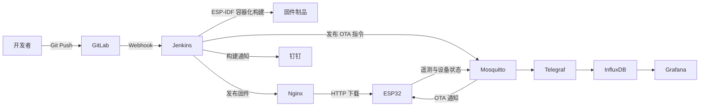
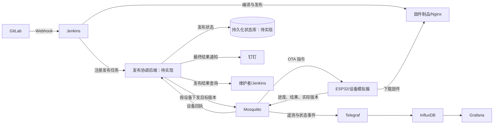

# 面向 ESP32 边缘设备的 OTA 持续交付与可观测性平台

本项目是一套面向 ESP32 边缘设备的 IoT DevOps 实践系统，目标是打通固件从代码提交、自动构建、制品发布、远程升级、健康确认、失败回滚到运行监控的完整链路。最终交付将加入轻量发布协调后端，统一管理发布任务、设备目标状态和升级结果；该后端目前仍处于设计阶段，不能将下文的目标架构视为已部署功能。

项目当前处于毕业设计与硬件联调阶段。构建、消息发布和 OTA 基础链路此前做过测试，但逐设备结果回执与持久化发布状态尚未实现，完整交付闭环仍需验证。真实传感器、安全加固、多设备管理和质量门禁也有待完善。本文档区分已实现能力、历史测试和规划能力，避免将实验环境描述为生产系统。

## 项目目标

- 降低嵌入式固件依赖人工编译、烧录和现场维护的成本。
- 使用 CI/CD 自动生成可追溯的 ESP32 固件制品。
- 通过 MQTT 通知设备拉取新固件，实现远程 OTA 升级。
- 使用 A/B 分区和启动健康检查降低升级失败导致设备失联的风险。
- 采集设备运行状态并构建设备端与服务端的统一监控视图。
- 通过故障注入和量化指标验证交付效率与升级可靠性。

## 课题定位与项目边界

本课题的工程问题是：传统固件发布流程往往只能证明“编译完成、升级指令已发出”，却难以回答“哪些设备最终运行了目标版本、哪些设备失败或回滚、离线设备如何补齐版本”。因此，项目重点是**可追溯的发布状态与可验证的设备升级闭环**，而不是把更多运维软件安装到同一台服务器。

- **主要使用者**：开发者在 GitLab 提交固件；Jenkins 执行构建与制品发布；维护者通过发布状态、日志和 Grafana 判断设备升级结果。
- **核心对象**：固件制品、发布任务、目标设备、设备上报的实际版本与升级事件。`release_id` 关联一次发布的构建、指令、设备回执和实验记录；`device_id` 区分同一发布下的各台设备。
- **演示边界**：真实 ESP32 用于验证 Flash 分区写入、重启健康确认和 Bootloader 回滚；模拟设备用于验证多设备协议、离线重连、超时和故障统计。模拟器不能替代真实硬件回滚证据。
- **完成口径**：至少能区分构建成功、制品已发布、指令已发出、设备已回执和设备升级成功；仅凭 MQTT 发布操作不能证明设备已收到指令。未收到设备确认、设备回报失败或回滚时，不得记录为升级成功。

## 当前系统架构

下图表示仓库中已经有代码或部署配置支撑的链路，不包含尚未实现的发布协调后端。



系统包含两条主要业务链路。

### 固件交付链路

1. 开发者向 GitLab 推送 ESP32 源码。
2. GitLab Webhook 触发 Jenkins 声明式流水线。
3. 目标流程中，Jenkins 先执行基础工程检查、格式检查、Cppcheck 静态分析、测试和敏感信息检查，再在固定 ESP-IDF 容器中交叉编译。
4. 流水线使用 Jenkins 构建号生成固件版本，并校验镜像格式、目标芯片、内部版本、分区容量和 SHA-256。
5. 验证通过的固件与发布清单先进入暂存区并归档，钉钉发送待审批通知。
6. 维护者在 Jenkins 查看构建报告并批准或拒绝；只有 `master` 或正式版本标签允许进入发布阶段。
7. 审批通过后，流水线再次核对 SHA-256，将同一份不可变固件提升到 Nginx 正式目录并登记发布任务。
8. Jenkins 或发布协调后端通过 MQTT 发布包含版本、下载地址、摘要和 `release_id` 的 OTA 指令。
9. ESP32 比较版本、下载并校验固件、写入备用 OTA 分区并重启。
10. 新固件完成版本和业务健康检查后标记为有效；失败时回滚并上报最终结果。

上述步骤是目标流程。当前仓库中的新版 Jenkinsfile 已实现构建侧固件门禁、归档、人工审批和审批后 SHA-256 复核，设备端也已实现固件大小与 SHA-256 校验；但服务器 Jenkins Job 尚未读取该版本并完成真实流程复验，Cppcheck 源码分析、真机故障注入和后端状态闭环仍待实现。

### 遥测监控链路

1. ESP32 周期性上报温湿度和设备健康数据。
2. Mosquitto 接收遥测消息，Telegraf 订阅并解析 JSON 数据。
3. Telegraf 将数据写入 InfluxDB，同时采集宿主机和 Docker 指标。
4. Grafana 查询 InfluxDB，展示传感器数据与设备运行状态。

## 目标架构与发布协调后端（规划中）

后端是最终项目的正式组成部分，但**当前仓库尚无后端代码、数据库模式或后端 Compose 服务**。设计目标是用一个职责明确的小服务补齐发布结果闭环，而不是再建一套 GitLab、Jenkins 或 Grafana 的替代品。



### 后端职责与边界

| 职责 | 计划行为 | 不负责的事情 |
| --- | --- | --- |
| 发布登记 | Jenkins 在制品可下载后提交唯一 `release_id`、版本、Commit、构建号、URL、大小、摘要及目标设备；后端按 `release_id` 幂等登记。 | 不重新编译固件，也不替代 Nginx 存放二进制文件。 |
| 目标状态管理 | 保存每台设备的期望版本、已报告版本和待处理发布；离线设备重新上线时检查是否需要补发指令。 | 不把一次 MQTT 广播当成持久化的设备期望状态。 |
| 结果归集 | 订阅设备回执，按 `release_id` 和 `device_id` 关联下载、校验、重启、健康确认、失败、回滚与超时事件；重复消息须幂等处理。 | 不将 MQTT 发布成功直接等同于设备升级成功。 |
| 查询与通知 | 提供发布任务及单设备结果查询；按最终结果通知钉钉，并为可观测性链路提供发布事件。 | 不替代 Grafana 的时序图表，也不建设通用设备管理后台。 |

发布任务和设备最终状态需要可查询、可恢复的**权威记录**；InfluxDB 继续承担遥测与指标分析，不默认兼任发布状态数据库。持久化方案与后端语言尚未定型，实施时以单机部署、可备份、可测试、易维护为选择标准，避免为了后端再引入一组不必要的中间件。

## 技术栈与组件状态

| 领域 | 组件 | 当前状态 | 作用 |
| --- | --- | --- | --- |
| 设备端 | ESP32、ESP-IDF 5.5、FreeRTOS | 已接入，硬件联调中 | 网络连接、遥测、OTA 和回滚 |
| 代码托管 | GitLab CE | 已启用 | 源码管理与 Webhook 触发 |
| 持续集成 | Jenkins | 已启用 | 容器化编译、版本生成、制品发布与通知 |
| 固件分发 | Nginx | 已启用 | 提供固件 HTTP 下载服务 |
| 消息通信 | Eclipse Mosquitto | 已启用 | OTA 指令、遥测和设备状态传输 |
| 数据采集 | Telegraf | 已启用 | MQTT 数据解析及主机、容器指标采集 |
| 时序数据库 | InfluxDB 2.7 | 已启用 | 遥测和监控指标存储 |
| 可视化 | Grafana | 已启用 | 设备与服务端监控面板 |
| 通知 | 钉钉机器人 | 已接入 | Jenkins 构建成功或失败通知 |
| 发布协调 | 轻量后端及持久化状态库 | 规划中，尚无代码 | 发布任务登记、设备期望版本、回执归集、超时判定与结果查询 |
| 源码静态分析 | Cppcheck | 规划中，待接入 | 作为 ESP-IDF/C 源码的主静态分析工具，检测空指针、数组越界、未初始化变量、资源泄漏和可疑逻辑 |
| 质量报告 | Jenkins Warnings NG | 规划中，待接入 | 汇总 Cppcheck 与编译器告警，展示文件、行号、严重度和变化趋势，并执行新增问题门禁 |
| 代码质量平台 | SonarQube 9.9 Community | 已部署，暂不作为主门禁 | Community 版本不直接提供官方 C/C++ 分析；仅在后续确有独立质量平台需求时评估导入外部报告 |
| 镜像仓库 | Harbor | 暂停使用 | 原计划管理容器镜像，因业务调整未进入当前链路 |

> 当前选型将“检测引擎”和“报告界面”分开：Cppcheck 负责源码静态分析，Jenkins Warnings NG 负责报告展示与质量门禁。ESP-IDF/GCC 编译告警作为补充，ESP-IDF Clang-Tidy 作为后续增强。SonarQube 暂不进入核心链路，避免只为展示报告而增加一套需要维护的服务。

## 当前已实现能力

### 自动化构建与发布

- GitLab Webhook 触发 Jenkins Pipeline。
- 使用固定 ESP-IDF Docker 镜像隔离构建环境。
- 根据 Jenkins `BUILD_NUMBER` 自动生成固件版本。
- 将固件发布到 Nginx，并通过 MQTT 下发 OTA 通知。
- 构建成功或失败后发送钉钉通知。

### ESP32 OTA 与恢复

- 使用自定义 4 MB Flash 分区表。
- 配置 `ota_0` 和 `ota_1` 两个应用分区。
- 以流式方式下载并写入备用分区，同时核对 HTTP 完整性、发布清单大小和 SHA-256；任一检查失败即调用 `esp_ota_abort()`，不切换启动分区。
- 仅当运行镜像处于 `ESP_OTA_IMG_PENDING_VERIFY` 时启动首次运行验证；稳定固件不会因 Broker 暂时不可用而进入周期性重启。
- 新固件健康确认同时要求业务任务启动、MQTT 连接、OTA 主题订阅确认和一次 QoS 1 遥测确认，不能再把“刚连上 MQTT”直接等同于固件健康。
- 启用 ESP-IDF Bootloader App Rollback。
- 使用 180 秒健康检查任务处理新固件无法完成业务自检的场景，失败后显式调用 ESP-IDF 回滚 API。
- Wi-Fi 断线后采用事件驱动方式重连，避免在事件回调中阻塞。

### 遥测与可观测性

设备当前每 2 秒上报以下数据：

- 温度与湿度。
- Wi-Fi RSSI。
- 剩余 Heap 内存。
- 连续运行时间。
- 当前固件版本。

Telegraf 同时采集宿主机 CPU、内存、磁盘以及 Docker 容器运行指标，并写入 InfluxDB 供 Grafana 展示。

## 当前项目进度（截至 2026-10-26）

下面沿用“模块状态 + 验证记录”的进度口径：**已实现**表示仓库中有对应代码或配置，**曾验证**表示此前有实测结果，**待复验**表示本轮未重新运行该链路。不要把服务部署、MQTT 指令发送和设备升级成功视为同一件事。

| 模块 | 状态 | 当前证据与剩余边界 |
| --- | --- | --- |
| 仓库与部署结构 | 已完成 | Wave 3 已由正式 Jenkins Job 读取并完成 dry-run；当前本地正在增加 Jenkins 固定运行镜像和阶段重启兼容性，尚未部署。源码、Compose、运行数据、固件制品和秘密配置已分目录。 |
| Jenkins 构建与发布 | Wave 3 dry-run 已通过，运行环境加固已部署 | 正式 Job `#42` 已完成构建、固件校验、人工审批和两个目标设备的 dry-run。包含 Python 3 的自定义 Jenkins 镜像已经部署；容器通过宿主机 Docker socket 的实际 GID 获得 API 权限，重启后的权限访问已经复验。Restart from Stage 仍待正式 Job 复验。 |
| ESP32 OTA 与回滚 | 正确性修复已构建，待真机复验 | `main.c` 已移除 HTTP 句柄释放后使用，下载错误、长度不符或 SHA-256 不符会中止 OTA；回滚健康检查只对 `PENDING_VERIFY` 镜像运行，并以业务任务、MQTT、订阅和遥测确认作为联合条件。已在服务器使用固定 ESP-IDF 5.5 镜像完成完整编译与固件门禁验证，但下载中断、摘要不匹配和健康检查超时仍需真实 ESP32 故障注入。 |
| 遥测与监控 | 多设备遥测已复验，面板待检查 | 服务器已同时收到 `sim-001` 至 `sim-005` 的独立 v1 遥测。Telegraf 已获得 Docker socket 补充组，并订阅 v1 遥测和 OTA 状态 Topic；InfluxDB 数据查询和 Grafana 面板仍待复验。真实温湿度传感器尚未接入。 |
| 设备模拟器 | 已部署并通过服务器端到端验证 | `simulator/` 已在服务器 Compose 中运行 5 个独立设备。隔离测试已验证正常升级、下载失败、SHA-256 不符、健康检查失败回滚和无最终回执五类行为，共收到 18 条 OTA 状态；容器重启后设备版本状态能够恢复。正式 Jenkins 非 dry-run 联调仍待完成。 |
| 发布协调后端 | 待实现 | 目标职责、状态模型和验收口径已写入本文；仓库中尚无后端入口、持久化模式、API 测试或部署配置。 |
| MQTT 文件日志 | 2026-10-15 曾验证 | 当时日志目录及文件对 UID 1883 可写，`iot-mqtt` 为 `healthy`；`scripts/start.sh` 已加入权限初始化。本轮未复查服务器运行状态。 |
| 质量、安全与论文材料 | 部分完成 | 流水线已生成镜像报告、容量报告、SHA-256、`manifest.json` 和完整 v1 `ota-notify.json`；9 个 Python 契约测试及发布脚本异常路径测试通过。设备端大小/SHA-256 校验及最小 OTA 状态回执已通过编译，但仍待真机复验；完整源码静态分析、令牌轮换和后端最终结果闭环仍待完成。 |

阶段性验证记录：

- **2026-10-15**：服务器上的 4 个 Compose 文件和启动脚本通过配置、语法及 Git 差异检查；MQTT 容器健康，已确认 UID 1883 可写日志。服务器仓库的修改提交为 `6fbe000` 并同步到本地 `master`；按当前决定，未推送服务器 GitLab 仓库。
- **2026-10-19（早期检查）**：本地静态核对了 `Jenkinsfile`、固件分区与 OTA 代码、模拟器脚本；当时 SSH 连接在认证前被服务器关闭，因此该次检查没有确认容器运行状态。
- **2026-10-19（第一阶段实施）**：在服务器临时目录使用 `espressif/idf:release-v5.5` 完成实际构建与固件门禁验证。测试版本 `v1.0.9001` 的固件大小为 932,640 字节，OTA 分区上限为 1,835,008 字节，镜像结构、内部版本和 SHA-256 校验通过；人为修改固件一个字节后，发布 dry-run 按预期拒绝。Jenkins 2.567 容器完成重建并恢复，3 个原有 Job 保留，制品目录可写，钉钉凭据已创建。该验证没有复制正式固件、没有发送 MQTT，也没有触发真实设备 OTA。
- **2026-10-23（OTA 正确性修复复验）**：将当前工作区以隔离方式上传到服务器临时目录，使用 `espressif/idf:release-v5.5` 完成源码基线检查、ESP32 全量编译和固件门禁验证。测试版本 `v1.0.999` 的固件大小为 949,040 字节，OTA 分区上限为 1,835,008 字节，容量状态为 `PASS`，镜像结构、内部版本和 SHA-256 校验通过。测试未修改服务器正式仓库、未复制正式固件、未发送 MQTT，也未触发真实设备 OTA；临时文件已清理。
- **2026-10-25（MQTT OTA v1 固件）**：ESP32 已改用 Wi-Fi STA MAC 派生设备 ID，订阅设备专属 Topic，并上报 v1 状态和遥测。固定 ESP-IDF 5.5 全量构建通过，固件大小为 950,928 字节，OTA 分区上限为 1,835,008 字节。
- **2026-10-25（多设备发布脚本）**：9 个 Python 契约测试、Linux Bash 语法检查、伪 Docker 发布行为测试全部通过；真实 Mosquitto Broker 上 `sim-ci-001` 与 `sim-ci-003` 各收到一条有效 v1 指令。测试只使用临时发布目录和非 Retain 测试 Topic，没有触发实体设备 OTA。
- **2026-10-25（正式 Jenkins dry-run）**：正式 Job `#42` 完成构建、人工审批和 Release OTA 演练；版本为 `v1.0.42`，SHA-256 为 `bef12049b02e1f92a139446671dc105f290ffb8483bf6b153d95ca6eb11247b8`，目标为 `sim-001`、`sim-003`。该次运行没有复制正式固件、没有发送 MQTT 指令，也没有触发设备升级。
- **2026-10-25（Jenkins 运行环境隔离验证）**：服务器临时目录成功构建 `iot-jenkins:2.567-jdk21-python3-test`，镜像默认用户仍为 `jenkins`（UID 1000），`python3` 位于 `/usr/bin/python3`，版本为 3.13.5。验证未重建正式 Jenkins 容器；测试镜像和临时目录已清理。
- **2026-10-25（Python 多设备模拟器）**：实现 5 个逻辑设备和 6 种行为模式；自动测试全部通过，其中下载测试使用本地 HTTP 服务真实传输固件并验证大小与 SHA-256。当前电脑没有 Docker；已在临时目录安装固定的 Paho MQTT 2.1.0 并验证 5 个客户端能够创建，服务器上的容器构建、Broker 连接和 Jenkins 非 dry-run 联调仍待完成。
- **2026-10-26（Jenkins 重启后 Docker 权限修复）**：确认宿主机 `/var/run/docker.sock` 为 `root:docker`、GID `991`、权限 `0660`，而旧 Jenkins 只有 GID `1000`。Compose 增加 socket 补充组，启动脚本动态读取实际 GID；重建后 Jenkins 显示 `groups=1000,991`，容器内 Docker API 返回 Server `29.5.3`。
- **2026-10-26（多设备模拟器服务器联调）**：停用 Docker daemon 的失效代理并重启 Docker，GitLab、Jenkins、MQTT、Nginx、InfluxDB 和 Grafana 均恢复。使用 Amazon ECR Public 上的 Docker Official Images Python 镜像补齐本地基础镜像后，构建并启动 `iot-device-simulator:1.0.0`。服务器收到 5 台模拟设备遥测；一次隔离 OTA 测试收到 18 条状态，`sim-001` 升级为 `v1.0.43`，`sim-002` 下载失败，`sim-003` 摘要不符，`sim-004` 回滚到 `v1.0.42`，`sim-005` 在 `received` 后静默。重启模拟器后 5 台设备重新上线，版本状态持久化正确。Telegraf 的 Docker socket 权限及 v1 Topic 订阅同步修复，服务器自动测试 33/33 通过。该测试没有向真实 ESP32 Topic 发布指令。

## 当前限制

项目仍处于测试阶段，目前存在以下已知边界：

- 温度暂时固定为 `99.9°C`，用于异常数据测试，尚未完成真实传感器联调。
- 设备已校验固件大小和 SHA-256，但尚未启用固件签名、Secure Boot 或 Flash Encryption。
- 当前只判断远端版本是否与本地版本相同，尚未实现防降级策略。
- OTA 采用 HTTP，MQTT 允许匿名访问，尚未完成 TLS、账号认证与 ACL 配置。
- Wi-Fi、MQTT 地址及部分服务凭据仍存在硬编码，后续需要迁移到 NVS、环境变量和 Jenkins Credentials。
- OTA 已使用设备专属 Topic，但尚未实现设备分组、灰度比例和批次暂停。
- Jenkins 发布 MQTT 消息后只记录“指令已发布”，尚未等待设备返回最终升级结果。
- Jenkins 自定义 Python 3 镜像和 Docker socket 补充组已经部署；发布元数据的 Restart from Stage 修复仍未由正式 Job 复验。
- 宿主机 Docker daemon 的 systemd drop-in 仍指向不可达代理 `192.168.100.1:7890`；Docker API 权限已恢复，但拉取未缓存镜像仍会超时。停用该代理需要重启 Docker，并短暂影响全部容器。
- 尚无发布协调后端，也没有持久化的“发布任务—目标设备—最终结果”关联记录；当前设备离线时会错过非 Retain 指令。
- 源码仓库、容器持久化数据、固件制品和本机秘密配置已经分离；旧目录暂时保留在归档区，待稳定运行后清理。

## 网络环境说明

项目测试环境包含两套网络：

| 网段 | 用途 |
| --- | --- |
| `192.168.100.0/24` | 内网服务测试 |
| `192.168.249.0/24` | 虚拟机桥接与 ESP32 联调 |

当前部分配置分别使用两个网段。后续计划将 IP、端口和凭据移入环境配置，避免因网络切换直接修改源码或流水线。

## 项目目录

```text
/data/devops/
├── iot-devops/               # Git 仓库：源码、部署配置、脚本和文档
│   ├── firmware/esp32-node/  # ESP32 固件工程
│   ├── deploy/               # GitLab、Jenkins、IoT、SonarQube Compose
│   ├── simulator/            # MQTT 遥测模拟器
│   ├── scripts/              # 统一启动、停止和状态脚本
│   └── docs/                 # 架构、部署和毕业设计文档
├── runtime/                  # 容器持久化数据，不进入 Git
├── artifacts/firmware/       # 已发布固件，不进入 Git
├── secrets/                  # 本机环境变量与秘密配置，不进入 Git
└── archive/                  # 迁移前目录和停用组件的可回滚归档
```

详细路径和数据边界参见 [`docs/deployment.md`](docs/deployment.md)。

## 本地启动

启动前，根据实际网段配置 `/data/devops/secrets/iot-devops.env`。该文件不会进入 Git。

```bash
cd /data/devops/iot-devops
./scripts/start.sh
```

查看服务状态：

```bash
cd /data/devops/iot-devops
./scripts/status.sh
```

停止服务：

```bash
cd /data/devops/iot-devops
./scripts/stop.sh
```

Python 模拟器已经包含在 IoT Compose 中。默认启动 `sim-001` 至 `sim-005`，其状态保存在 `${RUNTIME_ROOT}/simulator`：

```bash
cd /data/devops/iot-devops
docker compose --env-file /data/devops/secrets/iot-devops.env \
  -f deploy/iot/compose.yml up -d --build iot-simulator
docker logs -f iot-simulator
```

可在另一个终端直接观察 OTA 回执：

```bash
docker exec iot-mqtt mosquitto_sub \
  -t 'iot/v1/devices/+/ota/status' -q 1 -v
```

默认故障组合位于 `simulator/config.json`：`sim-001` 正常升级，`sim-002` 模拟下载失败，`sim-003` 在真实下载后模拟摘要不符，`sim-004` 模拟新版本健康检查失败后回滚，`sim-005` 在 `received` 后断开以供后端判定超时。旧的 `simulator/mock-esp32.sh` 仅用于兼容早期遥测演示，不参与 MQTT OTA v1 验收。

实现依据为 [Eclipse Paho Python 官方文档](https://eclipse.dev/paho/clients/python/docs/)、[Python `urllib.request` 官方文档](https://docs.python.org/3/library/urllib.request.html)、[Python `hashlib` 官方文档](https://docs.python.org/3/library/hashlib.html) 和 [ESP-IDF OTA 回滚官方文档](https://docs.espressif.com/projects/esp-idf/en/v5.5/esp32/api-reference/system/ota.html)。Paho 固定为 `2.1.0`，使用 Callback API v2；每台设备在 `on_connect` 中恢复订阅，状态消息使用 QoS 1 且等待发布确认。HTTP 下载明确绕过环境代理，避免内网固件地址被系统代理改写。

## OTA 消息格式

MQTT OTA v1 使用设备专属 Topic：

```text
iot/v1/devices/{device_id}/ota/command
```

Jenkins 为每个目标设备分别向对应 Topic 发布同一份已验证指令：

```json
{
  "schema_version": 1,
  "message_type": "ota_command",
  "release_id": "jenkins-40-36b122992057",
  "version": "v1.0.40",
  "target": "esp32",
  "url": "http://OTA_SERVER:8081/firmware_v1.0.40.bin",
  "artifact_size": 950928,
  "sha256": "64位小写十六进制摘要"
}
```

Jenkins 参数 `OTA_TARGET_DEVICE_IDS` 接收逗号、空格或换行分隔的设备 ID；`OTA_RELEASE_DRY_RUN` 默认开启，只校验目标、制品和 Topic，不复制固件、不发送 MQTT 指令。正式发布仍需通过 Jenkins 人工审批。

### MQTT OTA v1 协议与状态口径

ESP32 固件、Jenkins 发布脚本和后续模拟器共用 [MQTT OTA v1 协议](docs/protocol/mqtt-ota-v1.md)。后端发布登记仍属于规划内容，不能把下表中的后端接口字段理解为已经上线的 API。

| 消息 | 必需字段 | 作用与校验 |
| --- | --- | --- |
| 发布登记 | `release_id`、`build_number`、`git_commit`、`version`、`artifact_url`、`artifact_size`、`sha256`、`target_device_ids` | 同一 `release_id` 重试不得创建两个发布；后端须检查目标设备和制品元数据。 |
| OTA 指令 | `schema_version`、`message_type`、`release_id`、`version`、`target`、`url`、`artifact_size`、`sha256` | Topic 中的 `device_id` 是目标设备的权威标识；版本、大小或摘要不合法时设备拒绝执行。 |
| 设备回执 | `schema_version`、`message_type`、`release_id`、`device_id`、`stage`、`result`、`reported_version`、`target_version`、`uptime_sec`、可选 `reason` | 后端按发布与设备去重并记录时间；设备重启后必须再次上报实际运行版本及健康状态。 |

单设备结果建议按 `pending → downloading → verifying → rebooting → healthy` 流转，并允许在相应阶段进入 `failed`、`rolled_back` 或 `timed_out`。`healthy` 只能由目标版本重启后的设备回报产生；“指令已发送”和“下载完成”均不是终态成功。回滚应保留目标版本、实际运行的旧版本与失败原因，不能仅把它记成普通失败。超时由后端按发布任务判定；迟到回执保留为独立事件并标记为迟到，同时更新设备实际版本，不静默改写已经发出的超时结论。该规则需要状态迁移测试覆盖。

后端最小接口拟包括发布登记、按 `release_id` 查询汇总结果、按 `release_id` 查询逐设备结果及健康检查。设备侧仍通过 MQTT 通信，不为 ESP32 增加必须调用的 HTTP 管理接口。接口路径、错误码和数据库结构在后端实现前作为设计草案确定，不能把本节当作已经存在的 API 文档。

## 两周实施计划（开题阶段）

本节是从当前实现出发的 **14 天拟实施计划**，不是已完成功能清单。课题聚焦于“固件能否可追溯地交付、设备能否确认升级结果、失败后能否恢复”，不以增加平台组件数量作为成果。开题报告和 5–8 分钟 PPT 以这条主线组织。

现状依据：`Jenkinsfile`、`simulator/mock-esp32.sh`、`firmware/esp32-node/main/main.c` 和现有部署配置；回滚机制的验收依据为下方链接的 ESP-IDF 官方 OTA 文档。

### 两周内的交付边界

- 保留现有 GitLab → Jenkins → Nginx/MQTT → ESP32 → InfluxDB/Grafana 链路，优先完善它的结果确认与实验记录。真实硬件只要求 **1 块 ESP32 开发板**完成正常 OTA 和 Bootloader 回滚验证，不新增传感器作为关键依赖。
- 将当前仅发送遥测的 `simulator/mock-esp32.sh` 扩展或替换为可配置的设备模拟器：至少模拟 **5 个独立 `device_id`**，上报遥测、接收 OTA 指令、模拟下载与结果回执，并可注入超时或下载失败。模拟器用于验证消息协议、状态流转和监控链路；它**不能证明** ESP32 的 Flash 分区写入或 Bootloader 回滚正确。
- 为每次发布建立 `release_id`（可由构建号与 Git Commit 组成），让 OTA 指令、设备回执和实验记录可以关联。两周阶段先完成发布协调后端的最小可运行版本：登记任务、保存逐设备状态、接收回执、判定超时和提供查询；界面及复杂权限管理留到后续。
- 区分三个结果：**构建成功**表示固件制品生成，**发布成功**表示制品可下载且 OTA 指令已发出，**升级成功**必须由目标设备重启后回报预期版本及健康状态。设备回报失败、回滚或超过约定等待时间，都不能被记录为升级成功。

### 阶段安排与退出条件

| 时间 | 重点工作 | 可检查的交付物与退出条件 |
| --- | --- | --- |
| 第 1–2 天 | 固定演示范围，记录现有流水线与硬件的成功基线；整理开题报告和 PPT 提纲；轮换已进入仓库历史的测试凭据，并把通知凭据迁入 Jenkins Credentials。 | 留存一次构建号、Commit、制品版本和设备日志的对应记录；报告提纲能回答“做什么、为何做、如何验证”；不在新文档中写入凭据值。 |
| 第 3–5 天 | 定义 OTA 指令与设备状态的最小字段；扩展设备模拟器，支持独立设备 ID、版本、遥测、升级状态和可控故障。 | 5 个模拟设备可同时运行；同一次发布能分别观察成功、下载失败、超时等结果，日志可按 `release_id` 与 `device_id` 检索。 |
| 第 6–8 天 | 实现最小发布协调后端，将设备回执接入发布结果判断，并在 Grafana 展示在线状态、当前版本与升级结果。 | 发布任务及逐设备状态可持久化查询；未收到回执时明确显示超时，不发送误导性的升级成功通知。 |
| 第 9–11 天 | 用真实 ESP32 验证正常 OTA、下载中断和新固件健康检查失败后的回滚；先保存可串口恢复的已知正常固件。 | 每个场景至少重复 3 次，记录构建号、起止时间、设备日志、升级前后版本与结果；真实回滚以设备再次启动旧版本为证据，而不是模拟器日志。 |
| 第 12–14 天 | 汇总构建耗时、OTA 耗时、成功次数/总次数和回滚恢复时间；核对 README、论文草稿与实际证据；完成 5–8 分钟 PPT 和演示预案。 | 形成实验记录表、关键截图/日志、开题报告初稿和可讲清主线的 PPT；未完成能力明确标为“规划中”，准备录屏以应对现场网络或设备故障。 |

实验样本用于工程可行性验证，次数少时不宣称具有统计显著性。若第 8 天仍未打通设备回执，后续优先保证 **真实板正常 OTA + 回滚证据 + 可复现演示**，缩减多设备模拟与界面扩展，不牺牲核心闭环。

论文草稿中关于设备影子、状态对齐、MQTT Last Will 及其测试结果的表述，需要逐条与代码和原始实验记录核对；当前固件、模拟器与流水线尚无足够证据将其列为已验证成果。

### 本轮暂不纳入验收

真实多板灰度、传感器联调、Harbor、SonarQube 深度集成、完整设备管理后台，以及 TLS、Secure Boot、Flash Encryption 的生产级部署，不属于两周开题阶段验收；其中哪些进入最终毕设，按下方“核心必做/可选增强”划分。现有测试网络与明文通信只用于受控实验；公开代码或对外部署前，必须完成凭据轮换和相应安全加固。

## 完整项目交付范围与路线

以下描述的是**最终毕业设计**，不是前述两周计划。项目完成时应有一条可复现的真实板升级/回滚链路、一条可注入故障的多设备模拟链路，以及一个能持久化解释发布结果的后端。各阶段交付以前一阶段的协议和证据为输入，不能以“容器已启动”替代业务验收。

### P0：发布协议、制品和后端（核心必做）

- 冻结发布清单和回执字段，定义状态迁移、超时、重复回执、离线重连以及版本比较规则；为关键协议编写正常与异常测试。
- Jenkins 构建可追溯制品，记录 Commit、构建号、版本、大小与 SHA-256；在登记发布前验证固件文件可下载且摘要一致。
- 新建轻量发布协调后端和持久化状态库：登记发布、保存目标设备列表与期望版本、下发或重发指令、归集回执、判定超时、查询汇总和逐设备结果。重启后发布状态不能丢失。
- Jenkins 把构建与发布登记结果交给后端；最终设备结果由后端按状态触发通知。长时间离线的设备不应占住 Jenkins 执行器无限等待。
- 最小验收：同一次发布可追溯到固件和 Commit；至少两台设备给出不同结果时，后端分别正确显示，重复回执不造成重复成功计数；后端重启后记录仍在。

### P1：真实设备与多设备模拟（核心必做）

- ESP32 使用稳定的 `device_id`，接收定向指令；校验下载长度和 SHA-256，处理重复指令、无效版本、网络中断与异常退出，并报告错误原因、复位原因和重启后的实际运行版本。升级前还需跨重启保存待处理 `release_id`，否则旧固件回滚后难以说明自己对应哪次失败发布；具体持久化方式须经断电场景验证。
- 明确新固件健康条件：仅建立 MQTT 连接可能不足以证明业务可用；须验证目标版本、基本业务任务及必要的状态上报后，再确认新固件有效。保留串口救援和已知可用固件。
- 模拟器支持至少 5 个独立设备、不同当前版本、遥测与在线状态、OTA 指令消费、结果回执，以及下载失败、超时、离线后重新上线等故障注入。
- 后端按目标设备保存期望版本和实际版本；设备重新上线时能够发现未完成任务并补发或提示人工处理。这才是本文所称的最小“状态对齐”，不是单纯的 MQTT 广播。
- 最小验收：真实板分别完成正常 OTA 和新固件故障后的 Bootloader 回滚；模拟器展示成功、失败、超时和离线恢复。模拟器结果不能充当真实 Flash/Bootloader 验证。

### P2：监控、质量与安全（核心必做部分）

- 调整 Telegraf 的订阅与解析配置，将目标状态事件写入监控链路；Grafana 展示设备在线状态、实际版本、发布成功/失败/回滚/超时数量和关键耗时。Broker、后端和设备日志均能按 `release_id`、`device_id` 定位一次升级。
- 为后端状态迁移、MQTT 消息处理和模拟器故障注入建立自动化测试；流水线增加适用于 ESP-IDF/C 与后端代码的格式、静态检查、测试和制品校验门禁。
- 将凭据移出固件源码、Jenkinsfile 和可提交配置；轮换已进入仓库或历史的测试凭据，统一两套网段下的访问配置。受控实验环境至少限制可访问范围；对外部署前再完成 MQTT 认证与 ACL、固件下载 HTTPS/TLS 等加固。
- 最小验收：错误不能被成功通知掩盖；关键场景有自动测试和日志证据；新环境按部署文档能重新启动服务且敏感值不进入仓库。

### P3：实验、文档与答辩（核心必做）

围绕以下场景进行重复实验，记录样本数、环境、构建号、目标版本、设备 ID、原始日志和失败条件。小样本只用于工程可行性验证，不宣称统计显著性：

| 实验场景 | 主要指标 |
| --- | --- |
| 自动化构建 | 构建时间、成功率、制品可追溯性 |
| 正常 OTA | 下载时间、升级总耗时、业务恢复时间 |
| 下载中断 | 异常识别时间、设备可用性、恢复结果 |
| 固件损坏 | 校验拦截率、错误上报完整性 |
| 新固件故障 | 回滚成功率、平均恢复时间 |
| MQTT 或网络故障 | 重连时间、遥测丢失量 |
| 长时间运行 | Heap 变化、断线次数、系统稳定性 |
| 多设备模拟 | 消息吞吐量、通知延迟、升级成功率 |

最终交付包括：可复现的部署/恢复说明、协议与接口文档、测试脚本和实验记录、Grafana 截图、真实设备串口日志、开题报告、论文和 5–8 分钟阶段汇报 PPT。论文中关于设备影子、状态对齐、LWT 或“已验证”的结论，必须能定位到对应实现和原始记录；做不到时改为设计方案或未来工作。

### 可选增强，不作为上述闭环的前置条件

- 接入真实温湿度传感器并保留模拟模式；当前固定温度更适合故障测试，不能宣称真实测量能力。
- 增加分组灰度、人工审批、Web 管理界面、Wi-Fi/BLE 配网、MQTT Last Will、固件签名和更细粒度权限。
- 视实际价值再接入 SonarQube 或 Harbor；两者均不应替代适合本项目语言的测试、静态检查与制品追溯。
- Secure Boot、Flash Encryption 和生产级高可用部署只在有专用测试板和明确安全验收时评估，避免不可逆配置影响毕业演示。

### 最终验收的关键断言

1. 从任一最终设备结果，能反查 `release_id → device_id → 固件版本 → 构建号/Commit → 制品摘要`。
2. 指令成功发出但设备离线、升级失败、回滚或超时，均不能被统计或通知为“设备升级成功”。
3. 后端重启或 MQTT 短暂断连后，既有发布记录仍可查询；重复消息不会生成重复任务或覆盖已确认的最终结果。
4. 真实 ESP32 的回滚以重启后实际运行旧版固件为证据；模拟器只证明平台协议与结果处理。
5. README、论文和演示中“已实现/已验证”的范围，与代码、部署状态和实验材料一致。

### 关键设计判断

- **发布不是升级**：Jenkins 的成功只证明构建和发布阶段完成，设备端成功必须由重启后的目标版本与健康回执证明。通知、看板和论文中的“成功率”应分别注明统计阶段和分母。
- **状态库不是监控库**：发布任务、期望版本和最终结果需要可恢复的权威记录；InfluxDB 适合事件趋势与遥测分析。若只靠 MQTT 消息和 Grafana 曲线推断结果，重启、离线和重复消息会让“最终状态”失去可靠来源。
- **模拟器不是硬件证明**：模拟器能放大设备数量、快速注入故障，却无法证明 ESP32 分区表、Flash 写入和 Bootloader 回滚；真实板实验不可省略。
- **回滚必须能被归因**：设备回到旧固件只是硬件层恢复；若没有跨重启的发布标识或后端的版本对账，平台只能看到“没升上去”，无法可靠区分下载失败、启动失败和真正的 Bootloader 回滚。
- **最小后端比通用平台更有价值**：后端只解决任务、状态、结果和查询四件事。界面、复杂权限和新的中间件只有在解决明确验收问题时才引入，避免功能数量增长但闭环仍缺失。

## 预期 Jenkins 流水线

```text
代码提交
   ↓
基础工程检查 + Cppcheck 源码静态分析
   ├─ 失败 → 停止流水线并发送通知
   └─ 通过
        ↓
ESP-IDF 编译
   ├─ 失败 → 停止流水线并发送通知
   └─ 成功
        ↓
esptool 镜像检查 + 容量检查 + SHA-256 + 发布清单
   ├─ 失败 → 停止流水线并发送通知
   └─ 通过
        ↓
归档不可变固件
   ↓
钉钉通知“固件待审批”
   ↓
Jenkins 人工审批
   ├─ 拒绝或超时 → 不发布 OTA，保留构建记录
   └─ 通过
        ↓
再次校验固件 SHA-256
   ↓
复制到正式下载目录
   ↓
后端登记发布记录 + MQTT 下发
   ↓
设备下载、校验并写入备用 OTA 分区
   ↓
设备重启并执行健康检查
   ↓
设备上报成功、失败或回滚
   ↓
后端更新最终状态 + 钉钉通知
```

### 流水线修改原则

- 现阶段保留一个 Jenkins Pipeline，在其中增加质量门禁和人工审批，降低毕业设计的实现复杂度；后续设备数量增加时，再拆分为独立的 CI 构建任务和 Release 发布任务。
- Jenkins 顶层不长期占用 ESP-IDF 构建容器，每个需要计算资源的阶段单独申请执行节点；人工审批阶段不占用构建执行器，并设置明确超时时间。
- 所有分支都可以执行检查、测试、构建和固件验证，但只有 `master` 或正式版本标签可以进入审批和 OTA 发布阶段，避免开发提交不断产生待审批任务。
- 审批前只能将固件放入 Jenkins 归档或暂存目录；审批通过后才进入 Nginx 正式目录并发布 MQTT 指令。
- 审批对象必须是已经生成、验证并归档的确定固件。审批后禁止重新构建，发布前再次核对 SHA-256，确保实际发布内容与审批内容一致。
- 版本号通过 ESP-IDF 的项目版本机制注入，不再使用 `sed` 修改 `main.c`，避免构建工作区与 Git 提交内容不一致。
- 流水线中的检查逻辑分别沉淀到 `ci/check-source.sh` 和 `ci/verify-firmware.sh`，便于在本地复现，也避免 Jenkinsfile 变成难以维护的命令集合。
- 钉钉负责发送待审批、拒绝、超时和最终结果通知；审批先在 Jenkins 页面完成，以保留审批人、审批时间和构建记录。钉钉内交互式审批作为后续增强项。

### 源代码质量门禁

固件构建前至少完成以下检查：

| 检查项 | 建议处理方式 | 初期策略 |
| --- | --- | --- |
| 基础仓库检查 | 检查冲突标记、空白错误、异常大文件和构建目录误提交 | 失败即阻断 |
| 代码格式 | 使用仓库内统一的 `.clang-format` 检查 C/C++ 文件 | 失败即阻断 |
| 敏感信息 | 检查密码、Token、私钥及不应提交的环境配置 | 失败即阻断 |
| 静态分析 | 使用 Cppcheck 分析 ESP-IDF/C 源码并输出 XML 报告 | 先形成基线；`error` 和新增高严重度问题阻断 |
| 编译器诊断 | 收集 ESP-IDF/GCC 构建期间的 warning 和 error | error 直接阻断；warning 先统计再逐步收紧 |
| 报告展示 | Jenkins Warnings NG 汇总 Cppcheck 和编译器报告 | 保留构建趋势，并对新增问题执行门禁 |
| 单元测试 | 覆盖版本比较、OTA 消息解析、状态转换和后端核心逻辑 | 失败即阻断 |
| 配置检查 | 检查目标芯片、OTA 分区、回滚配置和必要构建参数 | 失败即阻断 |

源码检测的主工具确定为 **Cppcheck**，现有 `ci/check-source.sh` 继续负责仓库文件、OTA 分区和回滚配置等基础工程检查。Cppcheck 负责发现空指针、数组越界、未初始化变量、资源泄漏和可疑控制流等源码问题；Jenkins Warnings NG 只负责解析报告、展示文件与行号、统计新增/修复问题并执行质量门禁，不重复承担扫描工作。

静态分析初次接入不追求立即清零所有历史告警，应先确认真实问题与误报，再逐步收紧门禁。ESP-IDF Clang-Tidy 对实际编译参数和宏的理解更深入，但其工具链和接入成本更高，作为 Cppcheck 稳定运行后的增强项。SonarQube Community 不作为 ESP-IDF/C 的主检测器；如后续论文展示确实需要独立质量平台，只导入已经生成的检测报告，不让它成为新的必需构建依赖。

当前实施状态：`ci/check-source.sh` 的基础工程检查已经存在；Cppcheck 扫描、XML 报告、Warnings NG 展示及告警基线尚未接入，因此在完成真实 Jenkins 构建验证前不得写成“源码静态分析已完成”。硬件相关测试单独放入真实板验证阶段，不能用设备模拟器代替 Flash 和 Bootloader 行为验证。

### 固件质量门禁

构建完成后、人工审批前至少验证：

- 固件存在、非空，并能被 ESP 镜像工具正确解析。
- 目标芯片、固件内部版本与本次构建参数一致。
- 固件未超过 `ota_0`/`ota_1` 分区容量，并在接近容量上限前触发预警；初期可将 90% 作为预警参考线。
- 生成 SHA-256，并保存固件大小、构建号、Git Commit 和检查结果。
- 归档应用 BIN、ELF、MAP、分区表及必要构建报告，便于问题定位和论文实验复现。
- 生成 `manifest.json` 发布清单，至少包含 `release_id`、版本、构建号、Commit、目标芯片、文件大小、下载地址、SHA-256 和各项门禁结果。

固件检测不使用 Cppcheck 或 SonarQube，而是由 `ci/verify-firmware.sh` 串联 ESP-IDF 官方构建工具和通用摘要工具：

| 工具或步骤 | 主要职责 | 当前状态 |
| --- | --- | --- |
| `esptool image_info` | 解析 ESP32 应用镜像，核对镜像结构、项目名、目标芯片和内部版本 | 已实现并完成隔离构建验证 |
| `idf.py size`、`idf.py size-components` | 输出总体和组件容量报告，辅助定位固件体积增长 | 已实现并归档报告 |
| OTA 分区容量检查 | 将应用 BIN 大小与 `ota_0` 分区上限比较，超过上限阻断，达到 90% 给出预警 | 已实现 |
| `sha256sum` | 构建后生成固件摘要，审批后发布前再次计算并与归档摘要比较 | 已实现；真实 Jenkins 审批流程待复验 |
| `manifest.json` | 记录 `release_id`、版本、构建号、Commit、芯片、大小、下载地址和 SHA-256 | 已实现 |
| 真实 ESP32 启动与回滚验证 | 证明固件能够写入 OTA 分区、重启、通过健康检查或由 Bootloader 回滚 | 待形成可复查的真实板实验记录 |

这套门禁证明的是固件“格式可解析、版本可追溯、容量可容纳、内容未被替换”，不能单独证明固件一定能在真实 ESP32 上正常启动。设备模拟器只验证 MQTT、后端状态流转和通知链路；最终启动成功与回滚仍以真实设备的串口日志、运行版本和健康回执为证据。

MD5 可以保留用于兼容现有消息，但不能继续作为主要制品标识。设备下载完成后也必须计算并比对 SHA-256；服务器只计算摘要并不能证明设备收到的是同一文件。若后续需要证明固件来源可信，还应增加 TLS 或固件签名，因为普通哈希只能检测内容是否一致，不能完成发布者身份认证。

### 人工审批与发布状态

- 固件验证通过后，钉钉发送“待审批”通知，包含版本、构建号、Commit、文件大小、SHA-256、检查摘要和 Jenkins 构建链接。
- Jenkins 审批限制为指定用户或用户组，并记录审批人；建议设置 24 小时超时。拒绝或超时只终止发布，不删除已归档的构建证据。
- 审批通过后先复核归档固件 SHA-256，再将其从暂存区提升到不可覆盖的版本目录，随后登记发布任务并发送 MQTT 指令。
- 必须分别记录 `BUILD_PASSED`、`ARTIFACT_VERIFIED`、`AWAITING_APPROVAL`、`APPROVED/REJECTED/EXPIRED`、`RELEASED`、`DEVICE_HEALTHY/FAILED/ROLLED_BACK/TIMED_OUT`，不能把 Jenkins 成功直接写成 OTA 成功。
- 当前阶段 Jenkins 可以有限时等待设备结果；完整方案由发布协调后端异步接收设备回执、判定超时并发送最终通知，避免离线设备长期占用 Jenkins 任务。

仓库中的流水线第一阶段已经按以上方案完成代码改造和隔离构建验证，但 Jenkins Job 尚未读取这份新 Jenkinsfile，也未进行人工审批后的真实发布测试。在 GitLab 同步、Jenkins 构建记录和真实设备结果齐备前，不能将完整流程描述为已运行能力。

### 建议实施顺序

1. 接入 Cppcheck，生成 XML 报告并建立首份经过人工确认的告警基线。
2. 安装固定版本的 Jenkins Warnings NG，展示 Cppcheck 与编译器告警，先对 `error` 和新增高严重度问题执行阻断。
3. 增加代码格式、敏感信息和单元测试门禁；Cppcheck 稳定后再评估 ESP-IDF Clang-Tidy。
4. 将已经实现的人工审批、固件校验、SHA-256 复核和不可变制品发布放入真实 Jenkins Job 复验。
5. 修正钉钉通知语义，并接入后端发布记录与设备最终结果。
6. 最后增加分组灰度、TLS、固件签名及更完整的安全策略。

## 安全提示

当前仓库是实验环境，部分配置仍包含测试凭据和固定地址。公开仓库或用于正式环境前必须：

- 轮换已经写入文件或提交历史的密码、Token 和 Webhook。
- 清理数据库、日志、构建产物和私钥。
- 禁止匿名 MQTT 访问。
- 将所有敏感配置迁移到专用凭据管理机制。
- 在启用不可逆 eFuse 安全配置前使用专用开发板充分验证。

## 参考文档

- [Cppcheck 官方手册](https://cppcheck.sourceforge.io/manual.html)
- [Jenkins Warnings NG 插件](https://plugins.jenkins.io/warnings-ng/)
- [SonarQube 支持语言说明](https://docs.sonarsource.com/sonarqube-community-build/analyzing-source-code/languages/overview)
- [ESP-IDF OTA 与回滚](https://docs.espressif.com/projects/esp-idf/en/v5.5/esp32/api-reference/system/ota.html)
- [ESP-IDF Wi-Fi Provisioning](https://docs.espressif.com/projects/esp-idf/en/v5.5/esp32/api-reference/provisioning/wifi_provisioning.html)
- [ESP32 Secure Boot v2](https://docs.espressif.com/projects/esp-idf/en/stable/esp32/security/secure-boot-v2.html)

## 说明

项目用于毕业设计、个人技术实践和简历展示。当前目标不是堆叠中间件，而是构建一套可复现、可观测、可验证的嵌入式固件持续交付方案。

## 后续项目执行顺序

本节给出从当前仓库状态到毕业设计最终验收的推荐执行顺序。实施时按阶段推进：前一阶段达到退出条件后再进入下一阶段，避免同时修改协议、后端、设备和监控配置导致问题无法定位。

本节是当前生效的全局实施顺序；前文“两周实施计划”和流水线章节中的局部顺序保留为阶段规划与子系统说明，如有冲突以本节为准。

整体依赖关系如下：

```text
校准当前基线
   ↓
冻结 OTA 消息协议与状态机
   ↓
实现多设备模拟器
   ↓
实现最小发布协调后端
   ↓
Jenkins 接入发布后端
   ↓
完善 Telegraf 与 Grafana
   ↓
增加自动测试与代码质量门禁
   ↓
真实 ESP32 OTA 与回滚实验
   ↓
整理实验数据、论文、PPT 与演示材料
```

### 阶段 0：校准代码、运行环境和文档基线

**目标**：确保本地仓库、GitLab、Jenkins 实际读取的分支以及 README 对当前能力的描述一致。

执行内容：

1. 提交当前 `Jenkinsfile` 的说明性注释，并按需要同步到 GitLab。
2. 确认 Jenkins Job 使用的仓库地址、分支和 Jenkinsfile 均来自预期的 `master`。
3. 保存最近一次成功流水线的构建号、Git Commit、固件版本、文件大小、SHA-256 和 Jenkins 日志链接。
4. 更新 README 中已经过期的“待复验”描述，严格区分仓库中已有代码、服务器已部署以及端到端已验证三种状态。

**退出条件**：能够从一次 Jenkins 构建记录反查到 Git Commit、固件版本、归档制品和 SHA-256，并确认后续测试使用的确实是同一份代码。

### 阶段 1：冻结 OTA 消息协议和状态机

**目标**：为 ESP32、模拟器、后端、Jenkins 和 Grafana 建立唯一的数据契约，后续组件不得各自定义字段。

执行内容：

1. 核对当前固件和 `ota-notify.json` 的真实字段，统一 `url` 与 `artifact_url` 等命名差异。
2. 固定 OTA 指令的必需字段：`release_id`、`device_id` 或目标范围、`version`、固件 URL、`artifact_size` 和 `sha256`。
3. 固定设备回执字段：`release_id`、`device_id`、`stage`、`result`、`reported_version`、目标版本、时间和可选错误原因。
4. 以当前固件已经使用的阶段为基础统一状态：`received`、`downloading`、`verified`、`rebooting`、`healthy`、`failed`、`rollback`、`rolled_back` 和 `skipped`。
5. 定义重复消息、乱序回执、迟到回执、超时、版本相同、版本降级和设备离线时的处理规则。
6. 将正常升级、下载失败、摘要不符、健康检查失败和超时写成可重复的协议测试样例。

**退出条件**：同一组 JSON 样例能够同时作为固件、模拟器和后端的验收输入；字段含义及终态判断不再依赖口头约定。

### 阶段 2：实现可控的多设备模拟器

**目标**：在没有真实 ESP32 的情况下，验证从 MQTT 指令到设备最终回执的完整平台流程。

执行内容：

1. 将当前只发送随机遥测的 `simulator/mock-esp32.sh` 替换或扩展为可配置的 Python 模拟器。
2. 支持至少 5 个独立 `device_id`，每台设备保存自己的当前版本和最后一次发布状态。
3. 订阅 OTA 指令，真实下载 Nginx 中的固件文件，并核对 HTTP 结果、文件大小和 SHA-256。
4. 按阶段发布与真实固件一致的 JSON 回执，并模拟重启后报告实际版本。
5. 提供正常成功、下载失败、摘要不符、健康检查失败后回滚、离线和无回执超时等故障注入模式。
6. 使用 Docker Compose 启动模拟器，使其能够与现有 Mosquitto、Telegraf 和后续后端共同部署。

建议的首组模拟设备：

| 设备 | 预设行为 | 预期终态 |
| --- | --- | --- |
| `sim-001` | 正常下载、校验和重启 | `healthy` |
| `sim-002` | 模拟 HTTP 下载失败 | `failed` |
| `sim-003` | 真实下载后模拟 SHA-256 不一致 | `failed` |
| `sim-004` | 新版本健康检查失败 | `rolled_back` |
| `sim-005` | 上报 `received` 后断开 | `timed_out`，由后端判定 |

**退出条件**：一次发布能够同时得到成功、失败、回滚和超时结果；所有消息都能用 `release_id` 与 `device_id` 检索。模拟结果只用于证明协议和平台逻辑，不作为真实 Flash 或 Bootloader 的证据。

### 阶段 3：实现最小发布协调后端

**目标**：建立发布任务与设备最终状态的权威记录，不再仅依赖短暂存在的 MQTT 消息或 Grafana 曲线推断结果。

建议采用轻量 Python Web 服务和 SQLite；毕业设计单机环境无需提前引入复杂微服务、消息中间件或数据库集群。

后端最小职责：

1. 幂等登记发布任务及目标设备。
2. 保存版本、构建号、Git Commit、制品 URL、大小和 SHA-256。
3. 发布或补发 MQTT OTA 指令。
4. 订阅设备状态主题并保存原始事件。
5. 按状态机更新逐设备结果，拒绝非法倒退或无法解释的状态跳转。
6. 判定无回执设备超时，保留迟到事件但不静默篡改已经产生的历史结论。
7. 提供发布汇总、逐设备结果、设备当前版本和健康检查查询接口。
8. 后端重启后从数据库恢复未完成任务和已有结果。

建议的最小接口：

| 接口 | 用途 |
| --- | --- |
| `POST /api/releases` | 登记并启动一次发布 |
| `GET /api/releases/{release_id}` | 查询发布汇总结果 |
| `GET /api/releases/{release_id}/devices` | 查询逐设备状态和错误原因 |
| `GET /api/devices` | 查询设备版本与最后在线时间 |
| `GET /health` | 供容器和 Jenkins 检查服务状态 |

**退出条件**：后端重启后记录仍可查询；重复回执不会重复计数；同一次发布中的多台设备可以分别得到不同终态。

### 阶段 4：将 Jenkins 发布流程接入后端

**目标**：明确 Jenkins 和后端的职责边界，形成“构建发布”和“设备升级结果”两条相互关联但不混淆的链路。

目标流程：

```text
Jenkins 构建并验证固件
   ↓
人工审批
   ↓
再次校验 SHA-256 并发布到 Nginx
   ↓
调用后端登记发布任务
   ↓
后端持久化后发送 MQTT 指令
   ↓
Jenkins 记录 RELEASED 并结束
   ↓
后端异步接收设备最终结果并发送最终通知
```

执行内容：

1. 发布脚本在登记任务前再次确认固件可以下载且摘要一致。
2. Jenkins 将发布清单和目标设备提交给后端，不再直接把 MQTT 发布成功解释为设备升级成功。
3. 后端成功持久化任务后才能发送 OTA 指令，避免出现“指令已发出但没有发布记录”的状态。
4. Jenkins 的即时通知使用“发布任务已创建”或“OTA 指令已下发”等准确措辞。
5. 成功、失败、回滚和超时的最终钉钉通知由后端根据设备结果触发。
6. Jenkins 不长时间占用执行器等待离线设备；最终结果通过后端 API 和 Grafana 查询。

**退出条件**：Jenkins 成功只代表 `RELEASED`；设备没有回执时不会产生“升级成功”通知；从后端发布记录能够反查 Jenkins 构建和固件制品。

### 阶段 5：完善 Telegraf、InfluxDB 与 Grafana

**目标**：能够直接观察设备当前状态和一次发布的完整结果，而不是人工翻查多处日志。

执行内容：

1. 将 Telegraf 对 OTA 状态主题的采集从原始字符串改为结构化 JSON 解析。
2. 将 `release_id`、`device_id`、`stage`、`result` 和版本设置为可检索字段或标签。
3. 建立设备总览面板：在线数量、当前版本、最后上报时间、RSSI、Heap 和运行时间。
4. 建立发布结果面板：目标数、成功数、失败数、回滚数、超时数、成功率和升级耗时。
5. 建立逐设备事件时间线，能够观察 `received → downloading → verified → rebooting → healthy` 或异常分支。
6. Grafana 用于趋势和展示，后端数据库仍然是发布最终状态的权威来源。

**退出条件**：输入一个 `release_id` 即可查看该次发布的汇总结果和每台设备的阶段变化；看板统计结果与后端查询结果一致。

### 阶段 6：补充自动测试和质量门禁

**目标**：让协议、状态迁移和发布脚本的修改具有回归保护，避免只能依靠手工演示判断是否正确。

推荐实施顺序：

1. 为后端状态迁移、重复回执、乱序消息、超时和重启恢复增加自动测试。
2. 为模拟器的下载、大小校验、SHA-256 校验和故障注入增加测试。
3. 使用 ShellCheck 检查 `ci/*.sh` 和部署脚本。
4. 接入 Cppcheck 检查 ESP-IDF/C 源码并生成 XML 报告。
5. 使用 Jenkins Warnings NG 展示 Cppcheck 和编译器诊断，先阻断 `error` 和新增高严重度问题。
6. 增加敏感信息扫描，防止密码和 Token 再次进入提交。
7. Cppcheck 和基础测试稳定后，再评估 ESP-IDF Clang-Tidy 或 SonarQube 展示。

**退出条件**：正常升级及主要异常状态都有自动测试；测试或严重静态检查失败时，流水线在固件编译或发布前停止。

### 阶段 7：完成真实 ESP32 验证

**目标**：使用真实硬件补齐模拟器无法证明的 Flash 写入、分区切换、重启和 Bootloader 回滚证据。

在真实开发板暂时不可用时，前述模拟器和后端工作可以继续推进；Wokwi 可作为运行真实固件的补充验证，但不替代最终真机实验。

至少完成以下实验：

| 实验 | 关键证据 |
| --- | --- |
| 正常 OTA | 重启后设备报告目标版本并进入 `healthy` |
| 下载中断 | 当前固件继续运行，未切换到不完整镜像 |
| 摘要不匹配 | 设备拒绝固件并报告明确原因 |
| 新固件健康失败 | Bootloader 回到旧版本，并上报 `rolled_back` |
| MQTT 暂时断开 | 设备重连且稳定固件不出现周期性重启 |
| 长时间运行 | Heap、断线次数和遥测连续性有可检查记录 |

每个关键场景建议重复 3 次，并保存构建号、Commit、`release_id`、固件 SHA-256、设备 ID、升级前后版本、起止时间、MQTT 回执和串口日志。真实回滚必须以重启后运行旧版本为证据。

**退出条件**：正常 OTA 和故障回滚均有可复查的真实板日志；模拟实验与真机实验在文档中明确分开。

### 阶段 8：实验收口与毕业设计材料

**目标**：把已完成系统转化为可以复现、可以答辩、可以由证据支撑的毕业设计成果。

执行内容：

1. 汇总构建耗时、固件大小、OTA 耗时、业务恢复时间、成功次数、失败次数和回滚恢复时间。
2. 建立“结论—代码—构建—日志—截图”证据索引，保证论文中的关键结论可以追溯。
3. 修订 README、架构图、部署说明和接口协议，使“已实现、已验证、模拟验证、真机验证、规划中”的边界一致。
4. 核对论文中的分区大小、实验数据、参考文献和功能描述，删除没有实现或没有原始证据支撑的结论。
5. 制作 5–8 分钟 PPT，围绕问题、方案、流水线、设备闭环、异常恢复、实验结果和项目边界展开。
6. 准备演示脚本和录屏，在现场网络或设备不可用时仍能展示完整过程。

**退出条件**：论文、README、PPT 和实际系统对同一功能的描述一致；答辩演示可以在限定时间内稳定复现，并能解释一次发布中成功、失败、回滚和超时的区别。

### 暂缓实施的可选增强

以下内容只有在上述主线完成后再评估，不能作为后端、模拟器或真机实验的前置条件：

- Harbor 镜像仓库。
- SonarQube 深度集成。
- Kubernetes 或生产级高可用部署。
- 完整 Web 设备管理后台。
- 多租户和复杂权限系统。
- 大规模真实设备灰度发布。
- Secure Boot、Flash Encryption 和不可逆 eFuse 配置。
- 复杂传感器及额外硬件联调。

### 当前应立即执行的任务

下一步只推进一件事：**通过正式 Jenkins 人工审批，以非 dry-run 模式仅向 `sim-*` 设备执行一次多设备定向发布，并核对 Jenkins 发布记录与 18 条设备状态回执。**

Compose 构建、Paho 到 Mosquitto 的连接、正常升级以及四种异常路径均已通过服务器隔离联调。下一步只验证 Jenkins 的审批后发布入口是否能够复用同一协议和制品完成定向下发；目标必须限制为 `sim-001` 至 `sim-005`，不能包含真实设备。该联调不替代真实 ESP32 的 Flash 与 Bootloader 证据。

## 后续工作简版路线

1. 统一并冻结 MQTT OTA 指令、设备回执和遥测协议（已完成）。
2. 完成 Jenkins 多设备定向发布和 dry-run 验证（已完成；运行镜像与阶段重启加固待部署复验）。
3. 完成支持多设备和故障注入的 ESP32 模拟器（已完成服务器隔离联调；Jenkins 非 dry-run 待验证）。
4. 实现保存发布任务与设备状态的最小后端。
5. 将 Jenkins 发布流程接入后端，形成异步结果闭环。
6. 完善 Telegraf 和 Grafana，展示设备及发布状态。
7. 补充自动测试、Cppcheck、ShellCheck 和流水线质量门禁。
8. 使用真实 ESP32 完成正常 OTA、异常处理和回滚实验。
9. 整理实验数据，完成 README、论文、PPT 和答辩演示。
