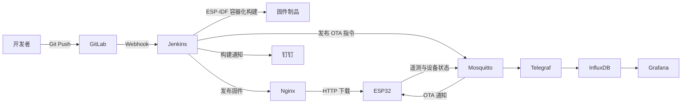

# 面向 ESP32 边缘设备的 OTA 持续交付与可观测性平台

本项目是一套面向 ESP32 边缘设备的 IoT DevOps 实践系统，目标是打通固件从代码提交、自动构建、制品发布、远程升级、健康确认、失败回滚到运行监控的完整链路。

项目当前处于毕业设计与硬件联调阶段。核心交付链路已经跑通，真实传感器、安全加固、多设备管理和质量门禁仍在持续完善。本文档会明确区分已实现能力和规划能力，避免将实验环境描述为生产系统。

## 项目目标

- 降低嵌入式固件依赖人工编译、烧录和现场维护的成本。
- 使用 CI/CD 自动生成可追溯的 ESP32 固件制品。
- 通过 MQTT 通知设备拉取新固件，实现远程 OTA 升级。
- 使用 A/B 分区和启动健康检查降低升级失败导致设备失联的风险。
- 采集设备运行状态并构建设备端与服务端的统一监控视图。
- 通过故障注入和量化指标验证交付效率与升级可靠性。

## 系统架构



系统包含两条主要业务链路。

### 固件交付链路

1. 开发者向 GitLab 推送 ESP32 源码。
2. GitLab Webhook 触发 Jenkins 声明式流水线。
3. Jenkins 在 `espressif/idf:release-v5.5` 容器中完成交叉编译。
4. 流水线使用 Jenkins 构建号生成固件版本，例如 `v1.0.35`。
5. 编译产物复制到 Nginx 固件目录。
6. Jenkins 通过 MQTT 发布包含版本、下载地址和摘要的 OTA 消息。
7. ESP32 比较版本、下载固件、写入备用 OTA 分区并重启。
8. 新固件连接 MQTT 后标记为有效版本；未通过健康检查时进入回滚流程。

### 遥测监控链路

1. ESP32 周期性上报温湿度和设备健康数据。
2. Mosquitto 接收遥测消息，Telegraf 订阅并解析 JSON 数据。
3. Telegraf 将数据写入 InfluxDB，同时采集宿主机和 Docker 指标。
4. Grafana 查询 InfluxDB，展示传感器数据与设备运行状态。

## 技术栈与组件状态

| 领域 | 组件 | 当前状态 | 作用 |
| --- | --- | --- | --- |
| 设备端 | ESP32、ESP-IDF 5.5、FreeRTOS | 已接入，硬件联调中 | 网络连接、遥测、OTA 和回滚 |
| 代码托管 | GitLab CE | 已启用 | 源码管理与 Webhook 触发 |
| 持续集成 | Jenkins | 已启用 | 容器化编译、版本生成、制品发布与通知 |
| 固件分发 | Nginx | 已启用 | 提供固件 HTTP 下载服务 |
| 消息通信 | Eclipse Mosquitto | 已启用 | OTA 指令、遥测和设备状态传输 |
| 数据采集 | Telegraf | 已启用 | MQTT 数据解析及主机、容器指标采集 |
| 时序数据库 | InfluxDB 2.7 | 已启用 | 遥测和监控指标存储 |
| 可视化 | Grafana | 已启用 | 设备与服务端监控面板 |
| 通知 | 钉钉机器人 | 已接入 | Jenkins 构建成功或失败通知 |
| 代码质量 | SonarQube 9.9 Community | 已部署，待接入 | 计划用于流水线质量检查；C 代码分析方案仍需确认 |
| 镜像仓库 | Harbor | 暂停使用 | 原计划管理容器镜像，因业务调整未进入当前链路 |

> SonarQube Community 版本对 ESP-IDF C 项目的分析能力有限。后续优先接入 `clang-format`、`clang-tidy` 或 `cppcheck`，再根据实际能力决定是否将结果汇总到 SonarQube。

## 当前已实现能力

### 自动化构建与发布

- GitLab Webhook 触发 Jenkins Pipeline。
- 使用固定 ESP-IDF Docker 镜像隔离构建环境。
- 根据 Jenkins `BUILD_NUMBER` 自动生成固件版本。
- 将固件发布到 Nginx，并通过 MQTT 下发 OTA 通知。
- 构建成功或失败后发送钉钉通知。

### ESP32 OTA 与恢复

- 使用自定义 4 MB Flash 分区表。
- 配置 `ota_0` 和 `ota_1` 两个应用分区。
- 以流式方式下载并写入备用分区。
- 通过 MQTT 连接结果进行新固件健康确认。
- 启用 ESP-IDF Bootloader App Rollback。
- 使用 3 分钟软件定时器处理新固件无法连接平台的场景。
- Wi-Fi 断线后采用事件驱动方式重连，避免在事件回调中阻塞。

### 遥测与可观测性

设备当前每 2 秒上报以下数据：

- 温度与湿度。
- Wi-Fi RSSI。
- 剩余 Heap 内存。
- 连续运行时间。
- 当前固件版本。

Telegraf 同时采集宿主机 CPU、内存、磁盘以及 Docker 容器运行指标，并写入 InfluxDB 供 Grafana 展示。

## 当前限制

项目仍处于测试阶段，目前存在以下已知边界：

- 温度暂时固定为 `99.9°C`，用于异常数据测试，尚未完成真实传感器联调。
- OTA 消息虽然包含 MD5 字段，但设备端尚未执行摘要校验。
- 当前只判断远端版本是否与本地版本相同，尚未实现防降级策略。
- OTA 采用 HTTP，MQTT 允许匿名访问，尚未完成 TLS、账号认证与 ACL 配置。
- Wi-Fi、MQTT 地址及部分服务凭据仍存在硬编码，后续需要迁移到 NVS、环境变量和 Jenkins Credentials。
- OTA 使用统一广播主题，尚未实现设备 ID、设备分组和灰度发布。
- Jenkins 发布 MQTT 消息后即认为发布完成，尚未等待设备返回最终升级结果。
- 源码仓库、容器持久化数据、固件制品和本机秘密配置已经分离；旧目录暂时保留在归档区，待稳定运行后清理。

## 网络环境说明

项目测试环境包含两套网络：

| 网段 | 用途 |
| --- | --- |
| `192.168.100.0/24` | 内网服务测试 |
| `192.168.249.0/24` | 虚拟机桥接与 ESP32 联调 |

当前部分配置分别使用两个网段。后续计划将 IP、端口和凭据移入环境配置，避免因网络切换直接修改源码或流水线。

## 项目目录

```text
/data/devops/
├── iot-devops/               # Git 仓库：源码、部署配置、脚本和文档
│   ├── firmware/esp32-node/  # ESP32 固件工程
│   ├── deploy/               # GitLab、Jenkins、IoT、SonarQube Compose
│   ├── simulator/            # MQTT 遥测模拟器
│   ├── scripts/              # 统一启动、停止和状态脚本
│   └── docs/                 # 架构、部署和毕业设计文档
├── runtime/                  # 容器持久化数据，不进入 Git
├── artifacts/firmware/       # 已发布固件，不进入 Git
├── secrets/                  # 本机环境变量与秘密配置，不进入 Git
└── archive/                  # 迁移前目录和停用组件的可回滚归档
```

详细路径和数据边界参见 [`docs/deployment.md`](docs/deployment.md)。

## 本地启动

启动前，根据实际网段配置 `/data/devops/secrets/iot-devops.env`。该文件不会进入 Git。

```bash
cd /data/devops/iot-devops
./scripts/start.sh
```

查看服务状态：

```bash
cd /data/devops/iot-devops
./scripts/status.sh
```

停止服务：

```bash
cd /data/devops/iot-devops
./scripts/stop.sh
```

启动模拟遥测前，请确认 `iot-mqtt` 容器处于健康状态：

```bash
cd /data/devops/iot-devops
./simulator/mock-esp32.sh
```

## OTA 消息格式

当前 Jenkins 向 `device/esp32/ota` 发布如下消息：

```json
{
  "version": "v1.0.35",
  "url": "http://OTA_SERVER:8081/firmware_v1.0.35.bin",
  "md5": "example-digest"
}
```

后续计划改为包含设备目标、Git Commit、文件大小和 SHA-256 的发布清单，并由设备返回下载、校验、重启和健康确认结果。

## 后续路线

### P0：工程整理与 OTA 可靠性

- 拆分源码、基础设施、监控、模拟器和测试目录。
- 忽略构建文件、日志、数据库、密钥和运行时持久化数据。
- 使用 `.env.example`、Jenkins Credentials 和 NVS 管理配置。
- 将固件校验从未使用的 MD5 升级为 SHA-256 或签名校验。
- 修复 OTA 资源生命周期及异常退出处理。
- 建立完整 OTA 状态机并向平台回传升级结果。
- 使用语义化版本或安全版本阻止旧固件降级。

### P1：硬件与多设备模型

- 接入真实温湿度传感器，同时保留可配置的模拟模式。
- 使用 ESP32 MAC 生成稳定的 `device_id`。
- 增加 MQTT Last Will、设备在线状态和复位原因。
- 将主题调整为 `devices/{device_id}/...`，支持单设备、分组和广播升级。
- 使用 SoftAP 或 BLE Provisioning 将 Wi-Fi 与平台配置写入 NVS。
- 在 Grafana 展示设备在线率、版本分布、升级进度和升级成功率。

### P2：安全与质量门禁

- 为 Nginx 配置 HTTPS，并在 ESP32 中校验服务端 CA。
- 为 MQTT 启用用户认证、最小权限 ACL 和 TLS。
- 引入应用固件签名验证；在专用测试板验证后再评估 Secure Boot 和 Flash Encryption。
- 在 Jenkins 中增加格式检查、静态分析、构建、制品校验、人工审批和部署结果确认阶段。
- 将 SonarQube 正式接入适合其版本和语言能力的代码检查流程。
- 仅在需要维护自定义构建镜像时重新引入 Harbor。

### P3：毕业设计验证

围绕以下场景进行重复实验并记录数据：

| 实验场景 | 主要指标 |
| --- | --- |
| 自动化构建 | 构建时间、成功率、制品可追溯性 |
| 正常 OTA | 下载时间、升级总耗时、业务恢复时间 |
| 下载中断 | 异常识别时间、设备可用性、恢复结果 |
| 固件损坏 | 校验拦截率、错误上报完整性 |
| 新固件故障 | 回滚成功率、平均恢复时间 |
| MQTT 或网络故障 | 重连时间、遥测丢失量 |
| 长时间运行 | Heap 变化、断线次数、系统稳定性 |
| 多设备模拟 | 消息吞吐量、通知延迟、升级成功率 |

## 预期 Jenkins 流水线

```text
Checkout
  → Format / Lint
  → Static Analysis
  → Build
  → Artifact Verification
  → Publish
  → Manual Approval
  → MQTT Deploy
  → Wait for Device Result
  → Notify
```

## 安全提示

当前仓库是实验环境，部分配置仍包含测试凭据和固定地址。公开仓库或用于正式环境前必须：

- 轮换已经写入文件或提交历史的密码、Token 和 Webhook。
- 清理数据库、日志、构建产物和私钥。
- 禁止匿名 MQTT 访问。
- 将所有敏感配置迁移到专用凭据管理机制。
- 在启用不可逆 eFuse 安全配置前使用专用开发板充分验证。

## 参考文档

- [ESP-IDF OTA 与回滚](https://docs.espressif.com/projects/esp-idf/en/v5.5/esp32/api-reference/system/ota.html)
- [ESP-IDF Wi-Fi Provisioning](https://docs.espressif.com/projects/esp-idf/en/v5.5/esp32/api-reference/provisioning/wifi_provisioning.html)
- [ESP32 Secure Boot v2](https://docs.espressif.com/projects/esp-idf/en/stable/esp32/security/secure-boot-v2.html)

## 说明

项目用于毕业设计、个人技术实践和简历展示。当前目标不是堆叠中间件，而是构建一套可复现、可观测、可验证的嵌入式固件持续交付方案。
