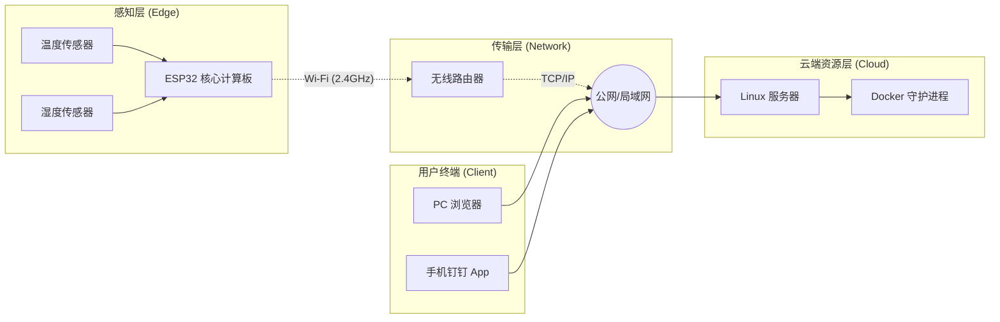
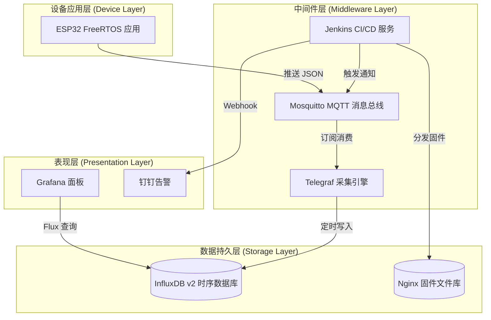
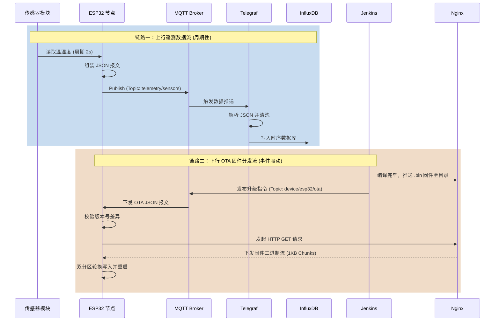
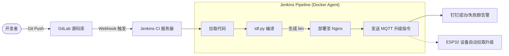
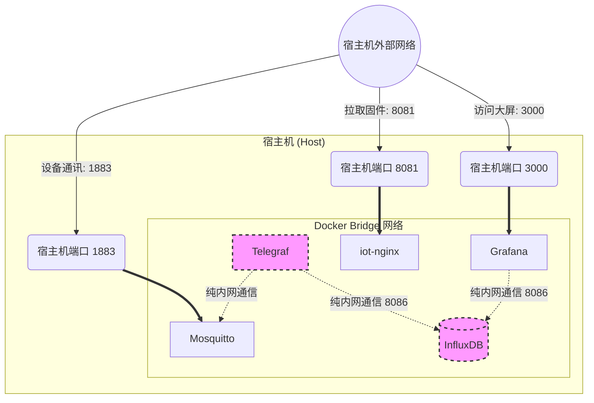
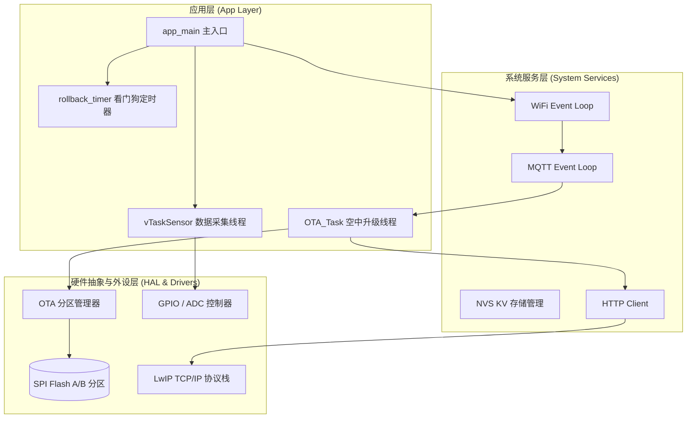

# IoT 项目核心架构图集 (Mermaid)

本篇档包含了可以直接渲染、也可以直接粘贴到您论文或 Markdown 编辑器中的 Mermaid 图表代码。

## 1. 物理拓扑架构图
展示了现实中硬件设备的连接层级。

## 2. 整体软件架构图
纵向切层的微服务/容器化设计。

## 3. 核心数据流转图
分为上行链路（遥测）和下行链路（OTA），使用时序图展示最佳。

## 4. DevOps 自动化流水线架构图
展示了代码从提交到设备升级的全生命周期。

## 5. Docker 容器网络隔离架构图
展示内部安全设计：哪些端口是对外暴露的，哪些是严格内网隔离的。

## 6. 嵌入式设备端软件架构图
展示 ESP32 内部基于 FreeRTOS 的层级和并发调度。

